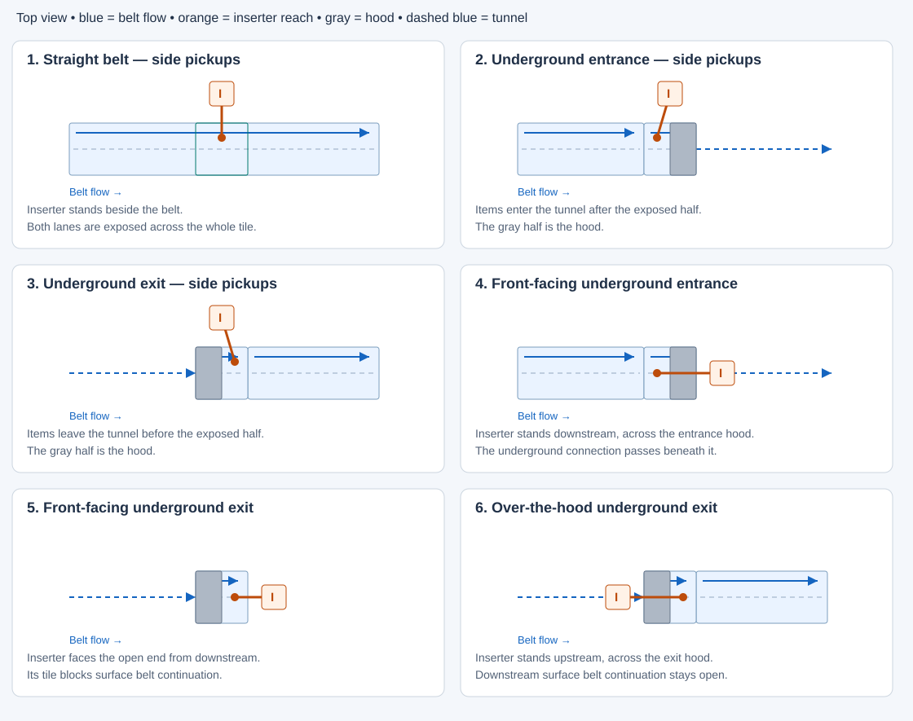
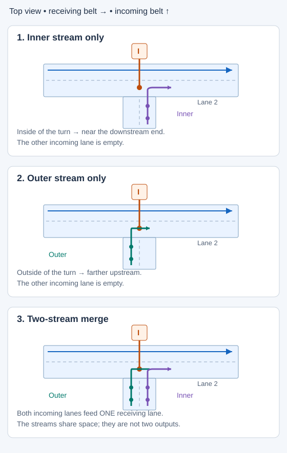

# Belt pickup diagram glossary

[Belt pickup documentation](README.md)

Use this glossary to read the [experiment coverage and tick-pattern matrices](experiments.md).
The [pickup timing reference](timing.md) pairs these layouts with grab-by-grab timelines and total ticks.
These are top-down schematics, not timing evidence or exact scaffold dimensions. An **I** marks an inserter;
its orange arm ends at the pickup or drop area. Blue arrows show belt direction. Gray blocks mark underground
hoods; dashed blue lines show underground connections. Actual layouts and screenshots are linked below.

## Pickup approaches

All six diagrams use belts running to the right. **Upstream** means where items come from; **downstream**
means where they go. The underground **entrance** takes items below ground; the **exit** brings them back up.
Only the exposed half of each endpoint is available for pickup.

### Side pickups

The inserter stands beside the belt. Straight belts, underground entrances and underground exits are three
variants of this category.

| Term | Meaning | Fixture screenshots |
| --- | --- | --- |
| Side pickups — straight belt | Inserter beside a straight belt; one full tile of each lane is exposed. | [Side pickups](../../tests/game/mechanics/belt-pickup/fixtures/different-items/README.md) |
| Side pickups — underground entrance | Inserter beside the endpoint where items enter the tunnel; half a tile of each lane is exposed. | [Side pickups](../../tests/game/mechanics/belt-pickup/fixtures/different-items/README.md) |
| Side pickups — underground exit | Inserter beside the endpoint where items emerge; half a tile of each lane is exposed. | [Side pickups](../../tests/game/mechanics/belt-pickup/fixtures/different-items/README.md) |

### Front-facing and over-the-hood pickups

The inserter stands inline with the endpoint rather than beside it.

| Term | Meaning | Fixture screenshots |
| --- | --- | --- |
| Front-facing underground entrance | Inserter downstream of the entrance, reaching back across its hood. The tunnel can continue beneath the inserter. | [Front entrance](../../tests/game/mechanics/belt-pickup/fixtures/front-underground-entrance/README.md) |
| Front-facing underground exit | Inserter downstream of the exit, reaching into its open end. The inserter occupies the tile needed for surface belt continuation. | [Front exit](../../tests/game/mechanics/belt-pickup/fixtures/front-underground-exit/README.md) |
| Over-the-hood underground exit | Inserter upstream of the exit, reaching across its hood. Surface belt continuation downstream remains open. | [Over-the-hood exit](../../tests/game/mechanics/belt-pickup/fixtures/over-the-hood-underground-exit/README.md) |

“Front” refers to these named fixture approaches, not a universal compass direction. Front-exit and
over-the-hood-exit pickups approach opposite ends of the same endpoint.

## Side-loading and merging

**Side-loading** means a belt feeds into the side of a straight receiving belt. The inserter picks up from
that receiving belt. This describes supply into the pickup tile; the **side pickups** category describes the inserter
standing beside the belt. They are separate properties.

The diagrams show an incoming belt travelling upward and turning right onto the lower receiving lane.
The other receiving lane stays empty. Inner and outer describe the incoming streams' turns, independently
of the inserter's preferred lane.

| Term | Meaning |
| --- | --- |
| Through supply | Items enter from the upstream belt in the same direction, traversing the whole straight pickup tile. See the straight-belt diagram above. |
| Inner stream only | Only the incoming lane on the inside of the turn carries items. It enters near the receiving tile's downstream end. |
| Outer stream only | Only the incoming lane on the outside of the turn carries items. It enters farther upstream on the receiving tile. |
| Two-stream merge | Both incoming lanes carry items and compete for space on **one receiving lane**. They do not supply two independent receiving lanes. |

See the [side-loading fixture screenshots and measurements](../../tests/game/mechanics/belt-pickup/fixtures/side-loaded-straight/README.md).
Reflecting the feed to the other side changes the physical lane numbers, while preserving the inner/outer names.

## Conditions applied to the layouts

These conditions can be combined with the approaches above. Stack positions in these diagrams are illustrative;
arrows show belt direction, including when stock is backed up.

| Term | Meaning |
| --- | --- |
| Moving supply | Items advance through the reachable area while the downstream route remains open. |
| Backed-up supply (`Moving = false`) | Stock queues against an obstruction. Picking up creates holes that refill at belt speed; this does not imply unlimited instantaneous supply. |
| Same item on both lanes | Either lane can supply the ingredient already being collected. The inserter can fall back when the preferred lane lacks reachable matching stock. |
| Different items on the lanes | The lanes carry different ingredients. Item selection also depends on what the destination accepts; lane preference alone does not guarantee a particular item. |
| Initial / shifted starting belt phase | Item positions differ when pickup is enabled. The shifted control opens the gate one tick later; see the [phase example](#phase-a-vs-phase-b) below. |
| Inserter mirroring | Toggle the inserter's mirroring setting without moving its tile. The tested front approaches prefer lane 1 unmirrored and lane 2 mirrored. |
| Reflected side pickups | Reflect the layout so the inserter approaches from the opposite side. This moves the inserter relative to the belt; it differs from toggling mirroring. |
| Belt drop | An inserter deposits onto a belt. The recorded tick pattern describes deposits rather than pickups. |

### Phase A vs phase B

Phase is the alignment of the item train with the pickup window when collection starts. In this measured turbo
example, A's next stack reaches the window sooner after the first two grabs, giving a **5-tick** hand rather
than B's **6-tick** hand. The positions illustrate the observed phase and quarter-tile spacing. A/B label these
examples locally; they are not belt modes or universal phase names shared across speeds.

A **first-hand** control observes one hand filling. A **repeated-hand** control continues through several
pickup/drop cycles, exposing stock depletion and refill that the first hand can conceal. An **operating-machine**
control also allows the destination to craft; clearing its inventory to isolate pickup does not establish throughput.

Normal, fast, express and turbo are speed variants of these layouts, not additional geometries. Diagrammed
layouts do not imply simulator support; the [coverage matrix](experiments.md#belt-speed-coverage)
marks support limits and measured disagreements. **Splitters are out of scope.**
