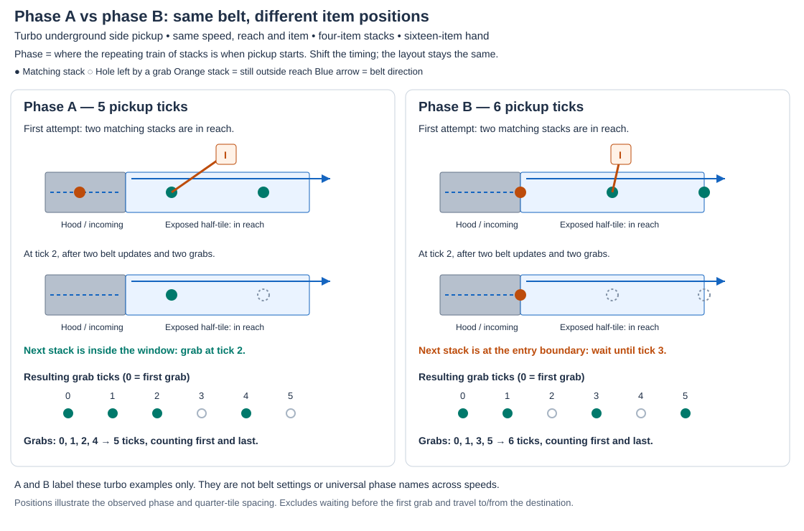
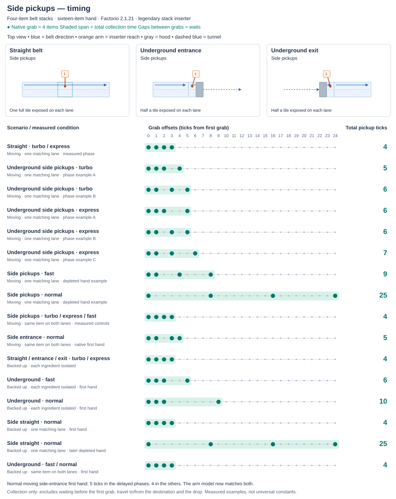
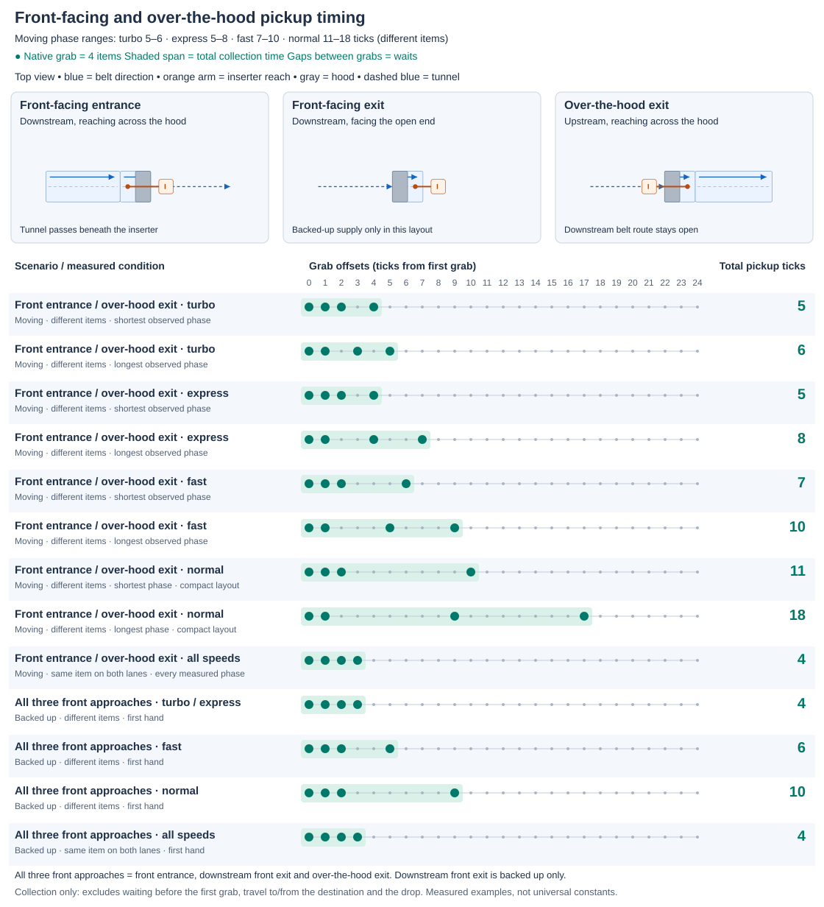
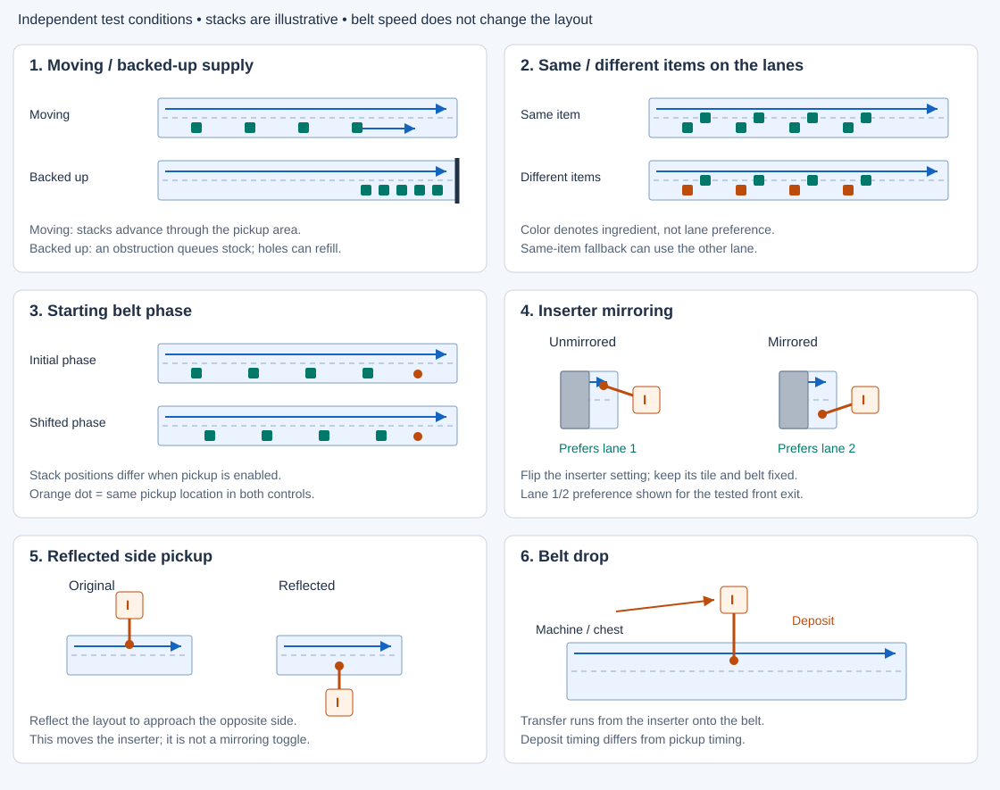

# Belt pickup timing reference

[Belt pickup documentation](README.md)

Each reference sheet includes its layout diagrams above the measured timelines, so the setup and pickup
ticks can be read together. They visualize the [tick-pattern matrix](experiments.md#tick-pattern-matrix),
rather than assigning a fixed duration to a belt type. Each row states its speed, supply condition and lane
contents or starting phase.

## Reading a timeline

Each green dot is one **four-item stack pickup**. Four dots fill a **16-item hand**. Tick **0** is the first
grab, not the tick the gate opens. The shaded span and total count include both the first and last grab:

- `0,1,2,3` fills the hand in **4 ticks**.
- `0,1,2,4` fills it in **5 ticks**, including the wait at tick 3.

All charts use the same tick scale. Totals exclude waiting before the first grab and travel to or from the
destination, including the drop. These measurements use Factorio **2.1.21** and legendary stack inserters.
A measured first hand or phase is a reference point; later holes, refill and destination eligibility can
change the next hand. Simulator agreement is tracked separately in the [coverage matrix](experiments.md#belt-speed-coverage).

## Phase A vs phase B

**Phase** means where the repeating train of items is relative to the pickup window when collection starts.
The layout, belt speed, stack spacing and ingredient can stay the same while those starting positions differ.

This turbo underground side-pickup example compares the two patterns labelled A and B in the sheet below.
Both start with two stacks in reach. After the first two grabs, A has its next stack inside the exposed window;
B must wait for its next stack to enter. The resulting hands take **5** and **6 ticks** respectively.
The positions reconstruct the observed phase and stack spacing; they are not screenshots of a native frame.

A/B/C identify example patterns **within each speed**, not universal phase values or fixed gate ticks. Express
has more distinct measured phases than turbo, so its example letters do not denote the same item positions.
An initial/shifted gate control changes when pickup starts; the actual item positions establish its phase.

## Side pickups

This category covers picking up from the side of a straight belt, underground entrance or underground exit. Blue arrows
show belt direction; the orange arm ends at the pickup area. Gray is the hood and dashed blue is the tunnel.
Moving underground examples show multiple observed phases. The fast/normal depleted-hand rows illustrate why
pickup can take longer after initial stock is consumed. Backed-up first hands do not establish repeated supply.

The normal moving side-entrance same-item control takes **5 ticks** in four measured phases and **4** in the
other four. The arm-reach model now matches both. Ordinary backed-up refill follows the finite-stock model.
Green dots always show the native observation.

## Front-facing and over-the-hood pickups

For moving supply with different ingredients on the two lanes, the diagram shows the shortest and longest
**observed phase examples**. Intermediate patterns remain in the tick-pattern matrix.

| Belt speed | Observed moving pickup range, different items |
| --- | --- |
| Turbo | 5–6 ticks |
| Express | 5–8 ticks |
| Fast | 7–10 ticks |
| Normal, compact layout | 11–18 ticks |

These moving rows apply to the **front entrance** and **over-the-hood exit**. The **downstream front exit**
blocks surface continuation, so its reference rows use backed-up supply only. Backed-up rows cover all three
front approaches and describe the first hand, not a sustained throughput guarantee.

Side-loaded pickup tiles, merges and splitters are out of scope. The
[experiment history](experiments.md#side-loaded-pickups-and-merges) keeps the measured side-loading timings.
Belt-drop timings describe **deposits** and are kept in the [separate calibration table](experiments.md#related-belt-drop-calibration).

## Supply and test conditions

These diagrams explain the conditions named in the sheets above. They can be combined with the pickup layouts;
stack positions here are illustrative rather than measured starting states. The belt-drop panel distinguishes
pickup from deposit timing, which is not included in the pickup totals.

