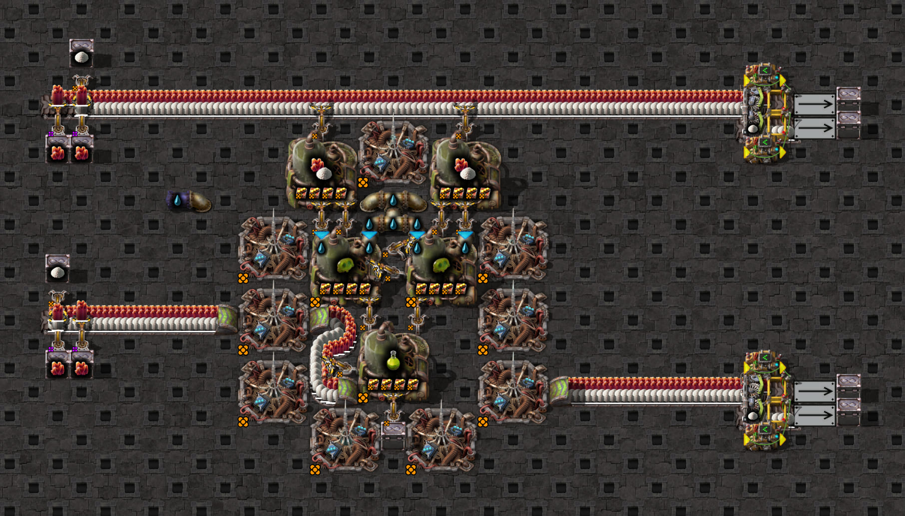

# Observed activation order

These Mechanics fixtures project short, selected native scheduling sequences into an offline scheduler primitive.
They do not change the simulation World's update loop. The primitive receives observed Alarms and membership
outcomes; it does not yet derive them from simulated machine consumption, source production, controls or hands.



The agricultural and agricultural-belt windows reuse the existing
[agricultural scaffold](../../../../resources/config-samples/science/agriculture-science/agriculture-science-scaffold.txt)
and its `agriculture-science` screenshot/catalog/provenance entry. This image shows the warmed layout, not the
captured state. Diagnostic LDS reuses the existing
[LDS scaffold](../../../../resources/config-samples/intermediates/low-density-structure/low-density-structure-scaffold.txt)
with a diagnostic clock reproducing the same-tick phenotype; the exact historical clock is unavailable. No new
scaffold/blueprint is introduced. See the [game evidence guide](../../README.md).

## Native observations and projection

The source is Factorio 2.1.21, binary SHA-256
`64a4dbc1a6de1e2556efd627f543d6072eaca6e69ee8b0c26df358bbd559adf7`. Three sealed normalized fixtures came from
bounded captures with fresh native/Lua getter mapping, code-byte/ASLR gates, exactly 20 advanced ticks and
zero differences against uninstrumented visible references. Raw recordings and generated probes stay in the
external 0.26.0 evidence package, outside the committed compact fixture tree.

| Projection | Actual ticks | Observation retained |
| --- | --- | --- |
| agricultural | 4836–4838 | Consumption attaches egg A then B; next Update order B → A → output. After blocked inputs leave membership, output take reattaches them for the next phase. |
| agricultural-belt | 4836–4838 | Belt input attaches after B; next Update order belt → B → A → output. First stack is visible in row 4839. |
| lds-diagnostic | 5629–5630 | Consumption attaches input; later control attaches output ahead of it. Next Update order output → input; output removal and input pickup are visible in row 5631. |

An Alarm is a delivered notification. Activation is inactive-to-active insertion; an Alarm on an already-active
member does not insert/reorder it in these observations. Update is an intercepted scheduled call. The original
Deactivation evidence is an interval between linked and inactive/self-linked observations, **not** an intercepted
detach call. The replay applies that outcome at the inactive observation ending the interval and retains both
bounds. It does not invent an exact detach time. Newer direct-deactivation experiments, if accepted, remain
separate evidence and do not retroactively upgrade these captures.

Each JSON retains selected event sequence/game tick/raw sequence, role and separate prepared/captured IDs,
observed state/link relations, original caller chains, actual attach entries/returns, bounded transitions,
contextual visible rows/assertions, binary/save/config/clock hashes, source scripts/observer/raw-log hashes,
reference-equality/handshake gates, source normalized-fixture SHA-256 and explicit limits. `SHA256SUMS` seals
these projections. Visible row t+1 contains transfers executed in actual tick t; visible state is contextual
native evidence, not physics output predicted by this scheduling-only replay.

From `clock-generator/`:

```bash
npm test -- src/simulation/active-scheduler.test.ts src/simulation/active-scheduler-native.test.ts
```

Ordinary CI reads JSON and the simulator primitive; it does not run Factorio or GDB. Acquisition used the
reusable method retained in the 0.26.0 `packages/codex-native-call-trace/reusable/` package. Reproject the original
sealed normalized evidence without a game or debugger:

```bash
python3 scripts/scheduler/project-native-fixtures.py /path/to/normalized/source-fixtures
```

The default destination is this fixture directory. The exporter verifies each source against its SHA256SUMS
before selecting the observation window. Full source captures are not copied into this directory.

## Component contract and remaining gates

The primitive owns active membership, relative order and a frozen Update-phase snapshot. New attachments go
ahead of older active members under this measured local policy. Attachment during an open phase waits for the
next phase, including reattachment before an old snapshot position has been consumed; no double Update occurs.
The caller supplies activation eligibility and deactivation outcomes separately from hand/control state.
State/clone/key representations include order, phase cursor and pending eligibility; diagnostic event causes and
counts do not affect recurrence. Alarm/Activation/Deactivation/Update events do not replace priced wake counters.

This validates a local scheduling interpretation, not universal subscriber/cross-chunk/thread ordering, complete
initial hidden state, every deactivation/eligibility cause, control replacement semantics or a full agricultural
shortfall cure. World integration still requires native alarm-source/hand outcomes, lifecycle/steady-state keys,
all existing native observations/pins, generation, blast/count and moved-pick native checks. No legacy timing
proxy, production requirement, native clock pin, timeout or priced counter has been changed here.

## Direct membership-transition complements

The [partial-hand source case](fixtures/partial-hand/README.md) and
[condition-assignment case](fixtures/condition-writes/README.md) add directly intercepted Deactivation
entry/return evidence. They do not upgrade the older inferred intervals. Scheduling-only replay now covers
real craft vs direct insertion and same-truth/false/true assignments with the observed native phase order.
Exact captured scaffolds, native layout JPEGs and generated screenshot provenance are retained.
