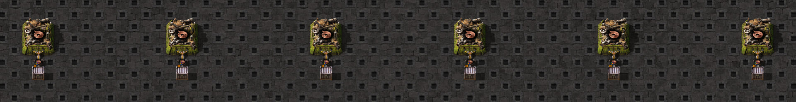

# Condition-assignment notifications

The [scaffold](scaffold.scaffold) has six copper-cable assemblers feeding legendary 16-item inserters and empty 48-slot
chests. Each hand is connected to its own zero-signal green chest network for condition assignments. The scaffold
alone does not include that wiring or the observation stock/interventions. Cells 1–3 begin with 8 source cable,
cells 4–6 with 16. Hands pick up their stock; none is injected into a hand.

Cells 1/4 receive false assignments after visible 5/12 and true assignments after 9/14. Cells 2/5 receive an
equivalent-true condition after 5; cells 3/6 receive no assignments. One actual craft per source follows visible 7.
These operations change existing conditions, not control objects or installed clocks.

The [screenshot provenance](../../../screenshots.generated.json) records the exact scaffold and game version.
It shows the warmed layout without the observation stock/interventions.

The fixture retains 26 alarms, 15 wakes, 21 directly observed sleeps and 42 updates. An equivalent-true assignment
can wake an asleep partial hand. A source alarm can wake a circuit-disabled hand, whose update sleeps without
pickup. At re-enable 9, assignment, update and sleep precede a distinct control-change alarm; update 10 takes two
items, visible in row 11. Initially full hands already delivered before disable, so this does not establish behavior
for a full carried hand across that edge.

Both repeats retain the complete 24-row reference and the exact selected event order, without an absolute-origin
shift. Actual tick k transfers appear in visible k+1. SHA256SUMS seals the fixture and scaffold. The local replay
supplies observed phase/wake/sleep outcomes; it does not predict their physical causes or hidden pending state.
