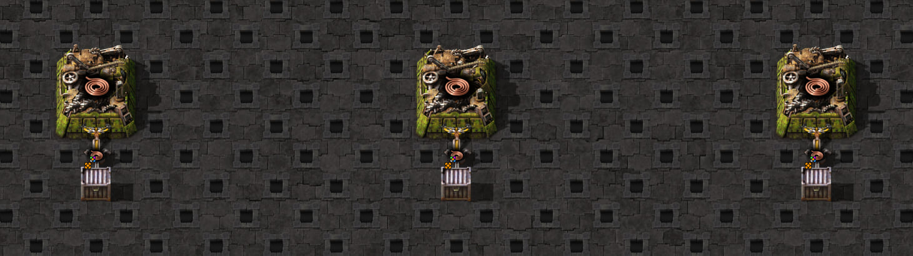

# Partial machine-source notifications

The [scaffold](scaffold.txt) has three copper-cable assemblers, legendary 16-item inserters and 48-slot chests.
Source outputs receive 0/8/16 cable; hands pick it up themselves. One craft follows visible row 8, using one copper
plate and progress 0.99. Direct insertion of 8 source output items after visible row 14 is a separate intervention.
The inherited disconnected condition setter was ineffective, so this case has no condition-assignment conclusion.

The [screenshot provenance](../../../screenshots.generated.json) identifies the exact scaffold and game version.
It shows the warmed layout without the observation stock/interventions.

The fixture preserves 20 updates, 14 alarms, 6 wakes and 6 directly observed sleeps. Partial hands sleep after a
top-up; a full 16-item hand stays awake to swing and delivers before source event 8. Craft 8 wakes hands 3,2,1;
updates at 9 are 1,2,3. Direct insertion at 14 wakes 1,2,3; updates at 14 are 3,2,1. These source-specific sequences
do not establish a universal subscriber order.

The first reference has exact 24-row equality. A repeat starts one absolute game tick earlier: absolute equality is
false, while equality after the declared installation-origin subtraction is true. Do not fit a phase to outputs.
Transfers in actual tick k appear in visible row k+1. The complete visible rows and initial inventory/topology remain.
SHA256SUMS seals the fixture and scaffold. Replay supplies observed notification/outcome data to the scheduler;
it is not a hand-physics prediction or a whole-factory cure.

## Derived source and hand outcomes

`src/simulation/inserter-scheduling-native.test.ts` also runs the production machine/hand notification components.
Source stock0/8/16 establishes carry through real setup pickups; a real plate/progress intervention makes2cable at8,
and a separately labelled live insertion adds8at14. No native membership or activation outcome is supplied. The
component matches all24visible rows and each hand's Alarm/Activation/direct-Deactivation/Update sequence. The sink's
single-item capacity is4800, equivalent to the measured empty48-slot chest for this cable-only, non-full interval.

This comparison deliberately does not force global cross-cell traversal order: native craft and direct insertion
visit these independent cells in opposite orders. Registration order is a simulator scenario, not a universal native
list policy. It also does not infer a condition-write rule from this disconnected/effectively enabled baseline.

Default World dispatch remains unchanged. A broader active-World trial passed this fixture but contradicted existing
native cold-start belt calibrations, so it was isolated and stopped without changing those assertions. These source
hooks and derived outcomes are an integration prerequisite, not a full agricultural/three-copy or timing fix.
