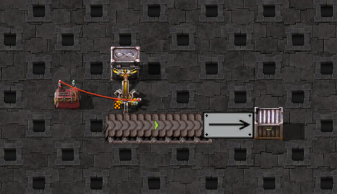

# Belt drop timing at all four speeds and stack sizes 1–4

Question: does `Belt::amountToDropAtTick` predict actual deposits at each effective belt stack size, without
changing researched technologies?

The [scaffold](scaffold.txt) has one legendary stack inserter taking iron from a source chest and depositing
onto an eastbound turbo belt. Two more straight tiles lead to an input loader and a receiving steel chest.
A constant combinator gates the inserter during 120 warm-up ticks. The source is empty during warm-up;
the probe then inserts exactly 32 iron plates into the source chest and releases the gate. The source is an
infinity chest with an iron filter set to **at least zero**, with unfiltered removal disabled: it identifies the
source item for capture but supplies no additional items. Conservation checks enforce that finite supply. In the original empty-output controls, belts and held
items are never seeded or edited. The receiving chest retains all deposits, so every item can be accounted for.



Native Factorio screenshot of the base layout, produced by the existing screenshot script and compressed to
quality-82, 562×324 JPEG (about 29 KiB from a 262 KiB PNG). It illustrates geometry; it does not show a measured deposit or prove timing.

The [probe](probe.lua) changes only `force.belt_stack_size_bonus` to `stackSize - 1`, using the writable
[LuaForce runtime property](https://lua-api.factorio.com/2.1.21/classes/LuaForce.html#belt_stack_size_bonus).
It compares the complete researched/level state of all technologies before and after that change and at the
end of capture. The inserter's configured hand override remains 16. The four turbo controls use the identical blueprint,
source quantity, geometry, direction, mirroring, warm-up and gate timing, each in its own fresh session/save.
Factorio version: **2.1.21**. The engine config is intentionally absent: this isolated chest-to-belt question
compares the exported `Belt` function directly, not a generated clock or a synthetic crafting machine.

## Findings

Offsets below start at the first actual native deposit, not arm arrival or gate release.

| Belt stack size | Effective full hand | First-hand native drop ticks | Drop offsets | Items per drop |
| --- | --- | --- | --- | --- |
| 1 | 16 | 6,7,8,10,12,14,16,18,20,22,24,26,28,30,32,34 | 0,1,2,4,6,…,28 | 1 |
| 2 | 16 | 6,7,8,10,12,14,16,18 | 0,1,2,4,6,8,10,12 | 2 |
| 3 | 15 | 6,7,8,10,12 | 0,1,2,4,6 | 3 |
| 4 | 16 | 6,7,8,10 | 0,1,2,4 | 4 |

The second full hand has the same offsets, starting at tick 42, 26, 20 or 18 respectively. The receiving tile
is empty before each hand starts dropping. All empty ticks as well as deposits match the production function.
The first three stacks appear at native line positions 3/8, 1/2 and 5/8 tile; subsequent stacks enter at 5/8.
Existing IDs move 1/8 tile per tick across the three straight tiles, with no compression or obstruction.
Each deposit creates one stack whose count matches the hand decrement and never exceeds the selected limit.

At stack size 3, the natural pickup is **15 rather than 16**. The engine already rounds belt-bound hands down
to a multiple of the lane stack size; its existing `handSizeFor` regression expects 15. This is a hand-capacity
effect, not a different deposit cadence. Two full hands deliver 30 items; the final two source items remain
held through tick 120, waiting for a full hand. Other sizes deliver all 32. Source + hand + every belt/loader
stack + receiving chest always totals 32, including that partial hand.

The original turbo measurements needed no production timing change. The speed backfill below identifies a
second-hand normal-belt constraint that an empty-belt timing function alone cannot predict.

## Four-speed backfill

The same layout is transformed consistently to express, fast or normal belts and loaders. Each speed/stack-size
combination runs in a separate save, with identical warm-up, gate release, hand override and finite source stock.
The probe now retains 360 ticks so even two normal-belt hands reach the chest. It verifies unchanged research,
the actual transport prototypes, every stack decrement and movement, and conservation of all 32 items.
[Native timing baselines](speed-expectations.json) contain both hands for all 16 combinations.

| Speed | Stack 1: first-hand offsets | Stack 2 | Stack 3 (15-item hand) | Stack 4 |
| --- | --- | --- | --- | --- |
| Turbo | 0,1,2,4,6,…,28 | 0,1,2,4,6,8,10,12 | 0,1,2,4,6 | 0,1,2,4 |
| Express | 0,1,2,5,8,10,13,16,18,21,24,26,29,32,34,37 | 0,1,2,5,8,10,13,16 | 0,1,2,5,8 | 0,1,2,5 |
| Fast | 0,1,4,8,…,56 | 0,1,4,8,12,16,20,24 | 0,1,4,8,12 | 0,1,4,8 |
| Normal | 0,1,8,16,…,112 | 0,1,8,16,24,32,40,48 | 0,1,8,16,24 | 0,1,8,16 |

All first hands start depositing at native tick 6. Every first-hand deposit and empty tick matches
`Belt.amountToDropAtTick`. Turbo, express and fast second hands have the same relative offsets as their first.
**Normal second hands instead use 0,8,16,…:** preceding stock still occupies the receiving tile, so the initial
two-stack burst is unavailable. Their first deposits occur at tick 126, 62, 38 and 30 for stack sizes 1–4;
the corresponding second-hand durations are 121, 57, 33 and 25 ticks. This is finite receiving-space behavior,
not a stack-size research change. Runtime now retains this output stock between hands; the empty-belt function
remains a reference for the first hand. The production comparison checks both hands without observed hand arrivals
or deposit ticks as inputs. It starts disabled with the same finite 32-item source.

The raw captures (#245) were not kept; the committed timing baseline ([speed-expectations.json](speed-expectations.json))
is portable and is their record. Publishing remains on hold.

## Occupied output and admission cutoff

The optional `seedPosition` control inserts one four-item copper packet into the receiving lane after native tick 5,
when the inserter naturally holds its full iron hand and has made no deposit. It never edits held items. The probe
retains the actual post-insertion position: `insert_at` shifts the requested coordinate by one movement step.
The total changes once from 32 to 36 items; iron and copper sink counts preserve conservation.

Sixteen coarse controls at express/normal speed and twelve cutoff controls at all four speeds produced the
[portable production clips](output-clips.json), alongside the original sixteen speed/stack-size runs. The cutoff
controls request positions `128 + 2 × speed`, plus/minus one 1/256-tile unit. Each runs in an independent save.
All 44 clips match the production inserter on every held quantity, finite source quantity and receiving-tile
packet position (9,120 ticks). Only the one observed copper seed is supplied; later pickups and deposits are predicted.

A deposit lands at its nominal spot plus one movement step, shifted upstream when preceding stock requires it.
The landing must stay strictly within a quarter tile behind the nominal spot. An insertion can compress the gap
of an upstream packet, which then waits while the gap reopens. This explains the observed cutoff without a fixed
per-hand delay. Runtime keeps this traffic across hands and control replacements. Explicit drop positions share
traffic; unspecified positions retain independent local output tiles. The downstream outlet must drain freely.

Fresh cutoff runs also compare the production model directly, rather than only preserving the native timing.
Uncaptured coarse controls for turbo/fast remain available as separate experiments; the committed evidence above
contains only the actual 44 recordings. The raw occupied-output reports (#251) were not kept.

## Reproduce

From `clock-generator/`, with the [game harness configured](../../../../README.md):

```bash
# Select one stack size at a time during investigation.
BELT_DROP_CAPTURE_DIR=.scratch/belt-drop/new-run npm run test:game -- tests/game/mechanics/belt-drop/turbo-stacks.game.test.ts -t '^express belt drops: stack size 3$'

# Affected native regression and offline checks.
npm run test:game -- tests/game/mechanics/belt-drop/turbo-stacks.game.test.ts
npm test -- src/entities/belt/belt.test.ts src/entities/inserter/inserter-hand-size.test.ts src/simulation/components/belt-hand-drop.test.ts
BELT_SPEED_CAPTURE_DIR=.scratch/belt-drop/new-cutoff npm run test:game -- tests/game/mechanics/belt-drop/occupied-output.game.test.ts -t cutoff
npm run screenshots -- --case=turbo-belt-drop-stacks
```

The retained run directory must be empty for each selected speed/size. Each gets its own subdirectory containing
the exact blueprint, composed probe, ordinary recorder output and `game/script-output/belt-drop-stacks.json`.
The report has a pre-release snapshot and 360 native tick samples of the hand, both chest quantities, and every
transport line's stack ID, position, item and count. The shared capture/snapshot helpers only observe; assertions
and production comparisons live in the game test. All four finalized controls passed (#237); their raw captures
were not kept.
