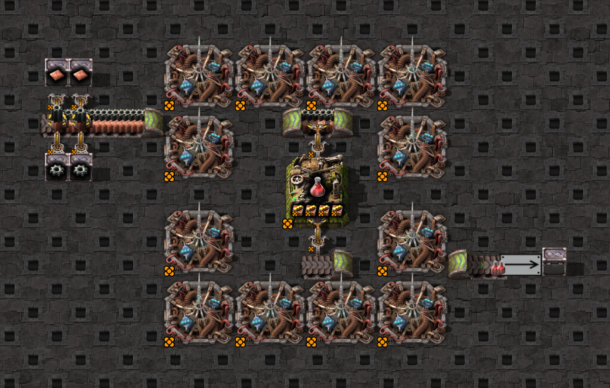
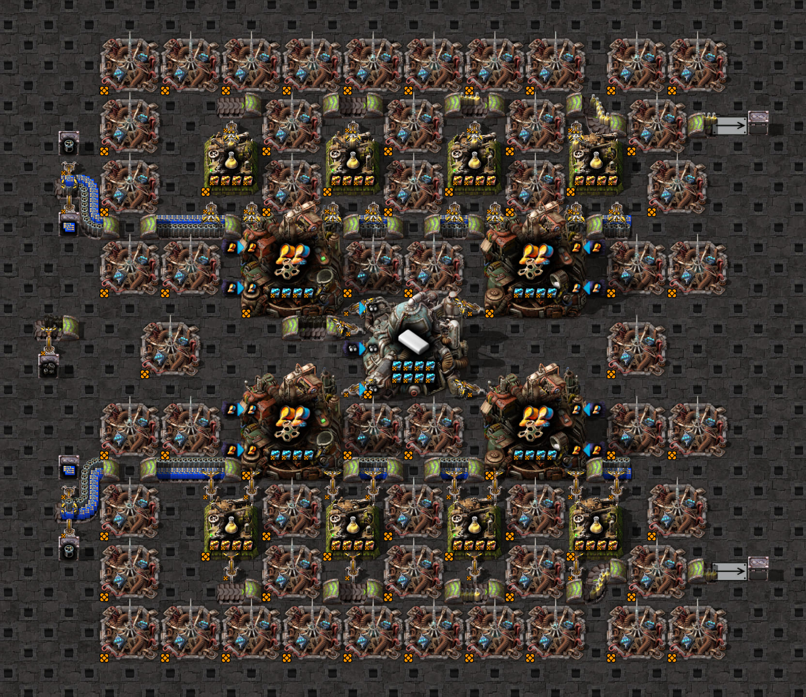

# Belt lane recording

`belt-lanes.game.test.ts` records the automation-science cell and checks drop-lane identity, occupancy and room
at each tick. `near-lane.game.test.ts` uses Thaeln's cell 09, where two belts carry processing units and robot
frames on opposite lanes. Their inserters must retain the processing-unit lane associated with their own belt.

## Scaffold views



The automation-science [source blueprint](../../../../resources/config-samples/science/automation-science/automation-science-scaffold.txt)
is shared with the clock-wiring test.



Thaeln's cell 09 [source blueprint](../../../../resources/config-samples/real/thaeln/cell09/thaeln-cell09-scaffold.txt)
is reused from the real-build samples. These are native layout screenshots after warm-up with the clock disabled;
they are not the tests' sampled states. See the [screenshot guide](../../README.md#scaffold-screenshots).

From `clock-generator/`, run just the desired check:

```bash
npm run test:game -- tests/game/mechanics/belt-lanes/belt-lanes.game.test.ts
npm run test:game -- tests/game/mechanics/belt-lanes/near-lane.game.test.ts
```
