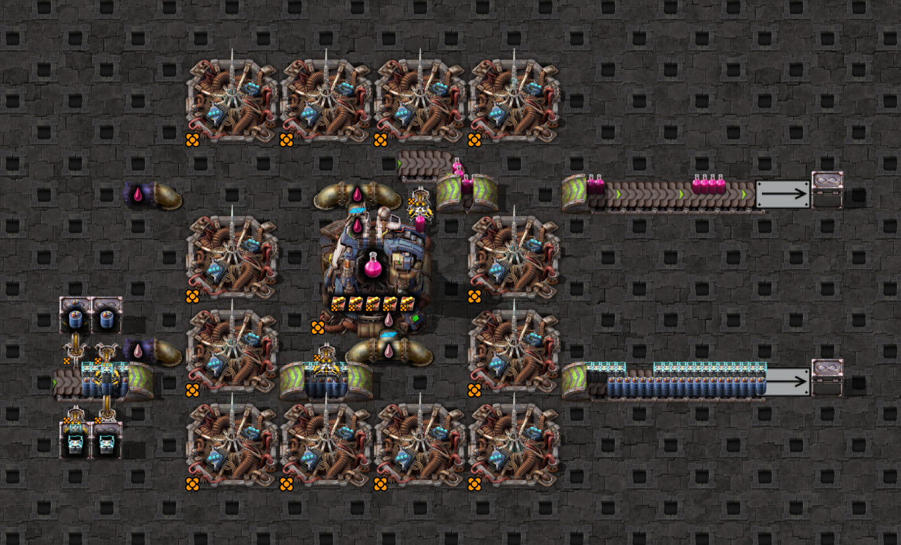
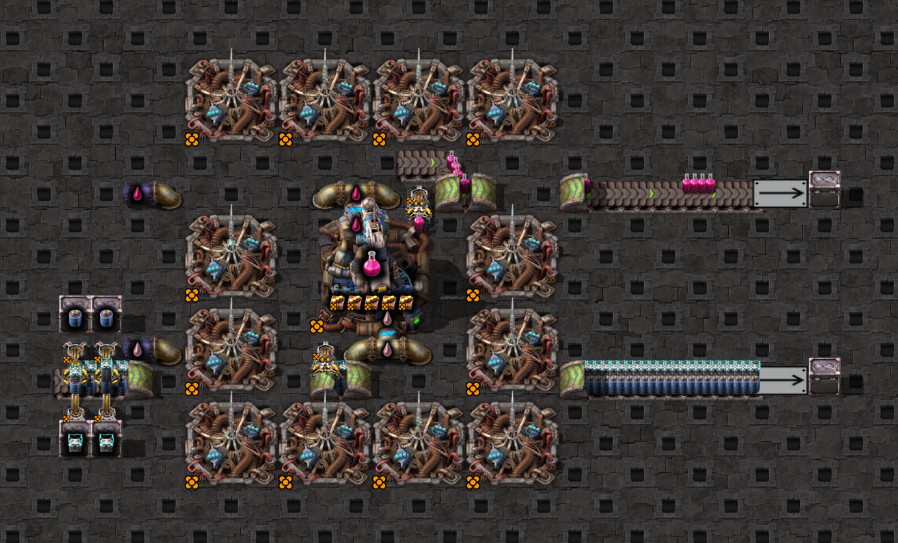

# Moving input pickup: different items on the two lanes

## Four-speed backfill

The 72 controls cover all four speeds, three pickup geometries, moving/backed-up supply and isolated
near/far ingredients or the same ingredient on both lanes. Fresh staged inserters stay circuit-gated for
64 ticks while the naturally fed lanes fill. Each capture then records repeated hands through tick 1300,
without placing belt stock or editing held items. Slower layouts shorten long ingredient tunnels while
retaining the pickup and plant positions; actual speed, reach, initial stock and supply motion are asserted.

Production held-count comparisons now match all 72 controls. The finite-stock queue resolves the original fifteen
backed-up discrepancies and also matches their exposed stock. The measured behaviors are:

- Fast backed-up single-lane supplies deplete, even on a straight belt. Later hands include `0,1,4,8`.
- Normal backed-up supplies also deplete, including same-item two-lane supply. Single-lane hands eventually
  reach `0,8,16,24`; two lanes help but do not guarantee consecutive grabs.
- Normal moving entrance pickup with the same item on both lanes has a first hand `0,1,3,4` where the
  stock-only reference predicts `0,1,2,3`. At the delayed tick the hand is visibly travelling between lanes.
  The production radial-reach model now reproduces that delay without a universal lane-switch penalty.

[Compact measured expectations](speed-expectations.json) retain actual hand patterns, counts, simulator
mismatch counts/first differences and independent-replay results. Production collection now agrees; generated-clock parity is a separate check. Comparing every depleted hand to
fresh full stock would also be invalid: the production comparison instead seeds observed full stock once and
retains its holes between hands, supplying only observed arm-arrival/drop boundaries.

The [production queue replay](../../jammed-pickup-replay.ts) matches all 36 backed-up controls:
seed the fully compressed lanes once at tick 64, advance stacks by the actual belt speed, clamp the head at
position zero and followers to quarter-tile spacing, then withdraw the upstream-most reachable matching stack.
Holes persist between hands; no instantaneous refill is assumed. Across 3,316 hand starts (including final
partial hands) and 44,496 consecutive transitions, held quantities and both exposed lanes' positions, counts
and items agree exactly. Native arm-arrival/drop boundaries are inputs to this replay; the whole simulation run from
placement, with no arrival given, reproduces these captures as well, every hand included (roadmap C1,
[startup](../../../../../../docs/belt-pickup/experiments.md#startup-from-placement)). The replay uses the same bounded queue as the generator.

Ten short [native clips](jammed-pickup-clips.json) retain all four speeds and full-/half-tile reach plus normal
same-item fallback. They run offline with:

```bash
npm test -- src/state/backed-up-pickup-lane.test.ts tests/game/mechanics/belt-pickup/jammed-pickup-replay.test.ts
```

The earlier three manual ingredient-demand controls are now automated at all four speeds. All 12 pass:
eligible near stock13 wins even when far stock is zero; swapping ingredients preserves physical preference;
near stock14 reaches the measured insertion limit and selection switches to the far ingredient. Machine
inventory is staged once and remains untouched during these demand captures.

From `clock-generator/`, choose one case and a fresh retained directory:

```bash
BELT_SPEED_CAPTURE_DIR=../work/belt-speed-coverage/new-run npm run test:game -- tests/game/mechanics/belt-pickup/belt-speed-coverage.game.test.ts -t '^express-straight-belt-moving-accumulator$'
BELT_SPEED_CAPTURE_DIR=../work/belt-speed-coverage/new-demand npm run test:game -- tests/game/mechanics/belt-pickup/ingredient-demand.game.test.ts
```

Use `BELT_SPEED_REPLAY_DIR` instead of `BELT_SPEED_CAPTURE_DIR` to check existing reports without launching
Factorio. Each case retains its exact blueprint/config, recorder output and compact findings. Updating a
baseline requires intentional discovery with `BELT_SPEED_DISCOVERY=1`, review of the native reports and a
normal regression replay afterward. Full raw data stays in ignored `work/` directories.

Evidence: `work/belt-speed-coverage/ordinary-gated-04/` and `ordinary-gated-05/` contain the 72 staged controls;
`demand-01/` contains the12 demand controls. Earlier express captures remain in `ordinary-01/`. Incorrect
setup/gate smoke runs are excluded from these findings. Absolute arm-arrival timing is not independently
calibrated by the production comparison.

## Original experiment

These scaffolds compare a straight belt, underground entrance and underground exit, with accumulators on lane 1
and supercapacitors on lane 2. The input inserter's nearest lane is 1. The belt drains continuously at its far end.
`config.json` uses a half-tile pickup, conservatively covering all three geometries; Sidecar captures the straight
piece's actual one-tile reach. A hand collects one ingredient at a time, so the other lane cannot fill its gaps.

The earlier always-full pickup assumption selected a 1,056-tick clock targeting 528 packs. In Factorio 2.1.21 it
missed that target in 30 of 35 periods on each underground endpoint, producing 480–528. The reachable-stack model
detects the shortfall and selects two output swings per cycle: 352 packs per 704 ticks, or 30 packs/second.
The initial verification held that rate in all 52 recorded periods on each geometry.

The current game regressions record at least 60 complete periods per run and check the selected default clock
on all three scaffolds, with moving supply and with the ingredient drain removed to back up the input belt.
Recovery runs withhold each ingredient in turn and block/restore output disposal, without resetting the clock or
machine. Moving checks allow six recovery periods. Backed-up checks settle for ten periods before measurement and
allow ten periods to recover; every later complete period must meet the target.

```bash
# From clock-generator/, with Factorio and the staging save configured in .env:
npm run test:game -- tests/game/builds/moving-pickup.game.test.ts
```

## Backed-up pickup regression

`backed-up-pickup.game.test.ts` removes the ingredient drain before placement and probes accumulators and
supercapacitors separately on each geometry. The scenario `backed-up-probe.lua`, composed with shared capture
helpers, clears the machine's input and output each tick
so the hand can fill without destination blocking. It records 1,200 ticks of hand counts and exposed lane stacks.
Filtering is explicitly enabled, other filter slots are cleared, and the held item must match the requested
ingredient. The untouched lane must stay stationary, the captured reach must match the geometry, and every complete
hand must match the simulator's `0,1,2,3` grab offsets. These offsets describe filling after the first grab, not arm arrival.

To retain one raw capture, from `clock-generator/` with `.env` configured:

```bash
npm run probe -- --fixture=backed-up --item=supercapacitor --geometry=underground-entrance --out=../work/belt-pickup/backed-up-run-01
```

Use `--item=accumulator` for the other ingredient and choose any of the three geometry names. The runner removes
the ingredient drain, selects the item, sets the matching config and composes the Lua helpers. It retains
`blueprint.txt`, `config.json`, `probe.generated.lua`, `recording.json`, and
`game/script-output/backed-up-pickups.json`. The scenario source alone is not directly runnable via `--lua`.
Sampling covers ticks 101–1300 after probe installation; destination clearing starts during the earlier ticks.
See the [game verification guide](../../../../README.md) for setup, cleanup and retention rules.

The original local probes left filtering disabled, so their "supercapacitor" labels did not establish far-lane
behavior. The regression above verifies both actual ingredients.

The clock tests in `moving-pickup.game.test.ts` also use explicitly backed-up configs with their pickup geometry
retained. All three geometries must hold the target output and recover after the same ingredient/output cuts as
the moving cases, without resetting the clock or machine.

```bash
npm run test:game -- tests/game/mechanics/belt-pickup/backed-up-pickup.game.test.ts tests/game/builds/moving-pickup.game.test.ts
```

## Mixed-item demand priority and insertion-limit fallback

Measured manually on 2026-10-18 in Factorio 2.1.21, using this straight-belt scaffold with the ingredient drain
removed. The eastward belt was backed up with four-item stacks on both lanes. The legendary stack inserter stood
north of the belt, nearest lane 1, with a hand capacity of 16.

A staged start saturated both lanes before placing a fresh, empty input inserter. Filters and circuit enable
control were disabled. The active plant started with 13 or 14 of the near-lane ingredient, none of the far-lane
ingredient, no products, and zero crafting progress. Inputs were set once, not cleared every tick: that difference
in stock was the condition being tested. The simulator's insertion limit is 14 for each ingredient at this plant's crafting speed
of 109.475. The second case swapped the ingredient feeders and config lanes while preserving the geometry and setup.
The third case retained those swapped lanes and changed only the initial near-lane stock from 13 to 14.

| Near lane / machine stock | Far lane / machine stock | First game grab | First simulator grab |
| --- | --- | --- | --- |
| Accumulator / 13 | Supercapacitor / 0 | 4 accumulators | 4 accumulators |
| Supercapacitor / 13 | Accumulator / 0 | 4 supercapacitors | 4 supercapacitors |
| Supercapacitor / 14 | Accumulator / 0 | 4 accumulators | 4 accumulators |

In all three cases, the first game sample still had an empty hand and both exposed lanes full. The first grab was
observed two ticks after probe installation, with machine stocks unchanged from their initial values. Only item
choice and grab quantity were compared, not arm-arrival timing.

For both ingredient arrangements, the completely missing far-lane ingredient did not override the near-lane
preference. Swapping the lanes changed the selected ingredient, consistent with lane preference rather than a fixed
preference for accumulators. At 14 supercapacitors, the inserter instead collected the missing far-lane ingredient.
Together, the swapped 13/0 and 14/0 cases support the modeled insertion threshold of 14 for supercapacitors in this
setup: prefer the near lane while its ingredient is accepted, then fall back to an accepted far-lane ingredient.
The existing simulator agrees with all three observations, so no simulator change was needed. These cases do not
establish insertion thresholds for other setups or behavior with moving supply, filters, or front-facing pickups.

The retained scenarios, runners, recordings, detailed samples and simulator comparisons are local under
`work/belt-pickup/mixed-demand-02/`, `work/belt-pickup/mixed-demand-swapped-01/`, and
`work/belt-pickup/mixed-demand-limit-01/` at the repository root. The original observations were manual; the four-speed controls above now automate this setup. They were not part of the original automated
game regression suite. Reproduction requires the staged setup and initial
inventories above; the backed-up capture command earlier in this file clears inputs and therefore does not reproduce
this demand experiment.

The [same-item iron-gear fixtures](../same-item) test fallback
between two lanes carrying the same item. See the [general pickup rules](../../../../../../docs/simulator.md#picking-up-from-moving-belts-and-underground-endpoints).
Original raw probes and clock recordings remain local under `work/belt-pickup-investigation/`.

## Scaffold screenshots

Native Factorio views of the committed base blueprints, with entity info shown. These illustrate the layouts;
they are not probe samples or evidence of pickup timing. The ingredient drain is present in these base views.

Straight belt:



Underground entrance:


Underground exit:



See the [screenshot guide](../../../../README.md#scaffold-screenshots) for capture settings and regeneration.

## Moving release-phase coverage

`ordinary-phase.game.test.ts` shifts the gate release after the same 600-tick staged saturation, keeping layout,
source stock, filters, mirroring and destination clearing fixed. The [phase probe](phase-probe.lua) verifies the
actual transport speed/prototypes and paired ingredient tunnels, keeps the target circuit-disabled and empty
through release, and records native stacks and hand positions. It clears machine inventories after observation;
these are isolated first-hand collection controls, not operating throughput measurements.

| Speed | Distinct quarter-spacing phases | Geometries × lane contents | First-hand controls |
| --- | --- | --- | --- |
| Turbo | 2 | 3 × 3 | 18 |
| Express | 8 | 3 × 3 | 72 |
| Fast | 4 | 3 × 3 | 36 |
| Normal | 8 | 3 × 3 | 72 |

The geometries are straight, underground entrance and underground exit. Contents are matching near lane,
matching far lane, or the same item on both lanes. The 36 release-at-64 controls reuse the earlier captures;
162 positive release shifts and an independent normal entrance repeat were captured separately. An offline
coverage assertion verifies all **198 actual first-grab phase/scenario combinations**, including each lane's
observed position modulo 64, rather than inferring coverage from release labels. All first grabs occurred two
ticks after release. Lane alignment remains that of the supplied scaffold; arbitrary independently shifted lanes
and sub-grid placements are separate questions.

The normal side-entrance family explains why collection needs arm reach:

| Geometry and contents | Moving | Actual first-grab phases (units of 1/256 tile, modulo 64) | Native grab offsets | Total pickup ticks | Production offsets |
| --- | --- | --- | --- | --- | --- |
| Normal underground entrance, both lanes same item | true | 56,48,40,32 | 0,1,3,4 | 5 | 0,1,3,4 |
| Same setup, remaining phases | true | 24,16,8,0 | 0,1,2,3 | 4 | 0,1,2,3 |

The first row corresponds to gate delays 0–3, and includes the independently repeated delay 0 result. Matching
far-lane stock exists while the hand moves between lanes during the extra tick. The production model extends/retracts toward the selected stack and checks radial collection reach. It now
matches all 198 phase/scenario combinations. The stock-only reference replay deliberately retains its four
counterexamples, demonstrating why stack availability alone cannot establish pickup timing.

Five small [native arm-travel clips](arm-travel-clips.json) preserve the delayed phases and one agreeing control,
including hand coordinates and stack IDs. Production tests check held quantities, both lanes and control
replacement with `npm test -- src/state/belt-pickup-arm.test.ts`. The separate stock-only reference test retains
the earlier discrepancy as evidence.

The [compact baseline](phase-expectations.json) preserves native patterns, corrected production comparisons and four stock-only reference
counterexamples. Native first-grab time conditions the comparison; the simulator is seeded once from gated stock,
without fitting later grabs or resynchronizing lane stock. Only production comparison results changed; measured native timing remains unchanged. The 199 replay checks (198 controls plus the coverage assertion) pass.

```bash
# Fresh native evidence for a selected phase; never reuse a populated capture directory.
BELT_SPEED_CAPTURE_DIR=../work/belt-speed-coverage/new-phase npm run test:game -- tests/game/mechanics/belt-pickup/ordinary-phase.game.test.ts -t '^normal-underground-entrance-moving-same-item-phase-1$'

# Recheck all retained evidence without launching Factorio.
ORDINARY_PHASE_BASELINE_DIR=../work/belt-speed-coverage/ordinary-gated-05 ORDINARY_PHASE_REPLAY_DIR=../work/belt-speed-coverage/ordinary-phase-02 npm run test:game -- tests/game/mechanics/belt-pickup/ordinary-phase.game.test.ts
```

Raw reports remain ignored under the two paths above. Failed setup pilots are excluded from findings. No production
simulator change or publication is included in this phase sweep.

## Reflected same-item controls

`ordinary-reflection.game.test.ts` reflects the entire speed-routed cell, preserving feeder contents, inserter
mirroring, gate release 64 and circuit connections. The input now sits north of the plant and its physical near
supply is **lane 2**. The native probe checks ingredient tunnel pairing and transport tiers; gated observations
verify full four-item stacks and actual moving or backed-up stock. Sidecar exports `near_lane: 2` at both reaches.

All **24 native controls** passed at four speeds × three side-pickup geometries × moving/backed-up supply,
covering **2,485 complete hands**. Every control has the same native pattern set, hand count and model-difference
count as its original lane-1 counterpart. The [frozen baseline](reflected-speed-expectations.json) keeps these
measurements separate from model agreement:

- Moving stock replay agrees in 11/12 captures. Normal underground entrance again takes `0,1,3,4` on the first
  hand instead of `0,1,2,3`; this is the same observed arm-travel gap on the opposite physical near side.
- Production held quantities now agree in all 24 captures, including the normal moving entrance's delayed ticks.
- The production finite backed-up queue matches both lane snapshots and held quantities in all 12 backed-up
  captures: 1,252 hand starts and 14,832 transitions. Combined with the earlier 36 ordinary backed-up controls,
  that is **48 captures / 4,568 hand starts / 59,328 transitions**. Starts include final unfinished hands; this is
  observation-conditioned production replay, rather than proof of absolute arm-arrival timing.

Raw evidence is retained locally in `work/belt-speed-coverage/ordinary-reflected-01/`. These controls use aligned
lanes and one gate release; they do not backfill every reflected release phase or historical interrupted window.

```bash
# New native capture (fresh directory required).
BELT_SPEED_CAPTURE_DIR=../work/belt-speed-coverage/new-reflected npm run test:game -- tests/game/mechanics/belt-pickup/ordinary-reflection.game.test.ts

# Recheck the retained 24 controls without starting Factorio.
BELT_SPEED_REFLECTED_REPLAY_DIR=../work/belt-speed-coverage/ordinary-reflected-01 npm run test:game -- tests/game/mechanics/belt-pickup/ordinary-reflection.game.test.ts
```

## Arm-reach regression

`ordinary-arm-travel.game.test.ts` captures all eight normal side-entrance phases from both physical near sides.
All 16 fresh controls agree with production held counts. The probe records actual prototype extension/rotation
speeds and native hand coordinates; it never moves the arm or inserts stock. Four phases take `0,1,3,4`, four
`0,1,2,3`, on either side. Initial stock and native first arrival condition the comparison; later stock is not
fitted back into the simulator. These are collection controls, rather than absolute startup or clock checks.

```bash
BELT_SPEED_CAPTURE_DIR=../work/belt-pickup-parity/new-arm-phases npm run test:game -- tests/game/mechanics/belt-pickup/ordinary-arm-travel.game.test.ts
```
