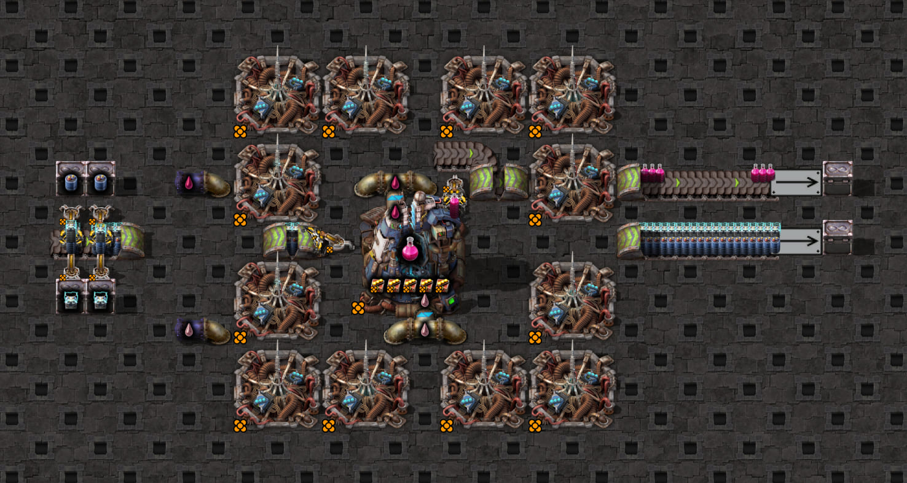

# Inline pickup from an underground entrance

Question: which lane does an empty inserter choose when it stands directly east of an eastbound underground
entrance, and how do mirroring and moving versus backed-up supply affect its first hand?

The user-supplied `scaffold.txt` retains its ingredient drain loader: **the base fixture is moving supply**.
The input inserter is west of the electromagnetic plant, facing west into the entrance. A separate upstream
underground exit feeds that entrance directly. The ingredient belt continues beneath the plant to its drain.
Lane 1 carries accumulators and lane 2 supercapacitors, in four-item stacks. The legendary input has no mirror
flag. The flipped variant uses `flipFrontUndergroundInput(blueprint, "entrance")` to change only this inserter's
`mirror` flag to `true`; its direction, position and both ingredients stay fixed. The probe checks the actual
`mirroring` property against the host's expectation. Fluids, modules, beacons and output disposal are retained.

For the backed-up case, `backUpFrontUndergroundEntrance` removes exactly the ingredient drain loader, preserving
the output drain and every other entity. Its position differs from the older side-pickup scaffolds, so their
plant-center-based drain selector must not be used here. All four cases stage the cell's inserters until the pickup
lanes have stayed full for 600 ticks. This allows back-pressure to travel through the long underground when the
drain is absent. Full lanes alone do not establish that a belt has stopped; the capture checks motion separately.

## Scaffold screenshot



The screenshot shows the original moving layout. The backed-up variant removes only the lower drain loader on
the right. The same-item moving variant keeps this geometry and feeds accumulators from both rows of chests.
This is a layout reference, rather than the probe's initial state or evidence of timing.
See the [screenshot guide](../../../../README.md#scaffold-screenshots) for settings and regeneration.

## Findings

Measured on 2026-10-18 in Factorio 2.1.21, with a legendary stack inserter, hand capacity 16, four-item turbo belt
stacks, and plant crafting speed 109.475. The empty input has filters and circuit enable control disabled. The
probe clears machine inputs/output once, checks zero initial crafting progress, then observes ticks 1–30 using
the shared capture and belt snapshot helpers. It does not insert belt items, modify feeder hands, or refill supply.

| Mirrored | Supply | Selected lane / item | Grab offsets | Hand counts at grabs |
| --- | --- | --- | --- | --- |
| No | Moving, original drain retained | 1 / accumulator | `0,1,2,4` | `4,8,12,16` |
| No | Backed up, ingredient drain removed | 1 / accumulator | `0,1,2,3` | `4,8,12,16` |
| Yes | Moving, original drain retained | 2 / supercapacitor | `0,1,2,4` | `4,8,12,16` |
| Yes | Backed up, ingredient drain removed | 2 / supercapacitor | `0,1,2,3` | `4,8,12,16` |

Both initial exposed half-tile lanes contain two four-item stacks. The first grab is at probe tick 2 in all four
cases. Machine inputs/output remain empty and crafting progress stays zero through each first hand. The recipe's
default simulator order chooses supercapacitors; choosing accumulators instead is evidence for lane preference
over that fixed recipe order. Changing only the input's mirroring switches its choice to lane 2 supercapacitors
under both supply conditions, while leaving each condition's first-hand timing unchanged. In each backed-up case,
the unselected lane's stack IDs and positions stay unchanged throughout the first hand. With the drain retained,
the unselected lane moves even though none of its items are collected.

The existing simulator supports these observations with explicit `near_lane: 1` unmirrored or `near_lane: 2`
mirrored, and `pickup_length: 0.5` in both. `config.json` holds the unmirrored moving case; the flipped test changes
its explicit lane preference. The backed-up test changes `overrides.backed_up_belts` to `true` as well
as removing the loader from the blueprint. Backed-up first-hand counts match directly. Moving counts match one
of the model's two turbo stream phases, including the pause before the fourth grab. The comparison checks phase
compatibility; it does not infer the starting phase from the blueprint or calibrate absolute arm-arrival timing.
No engine behavior change was required for these measured first hands.

Sidecar 0.11.0 captures this preference automatically: `near_lane: 1` unmirrored, `near_lane: 2` mirrored, and
`pickup_length: 0.5`. All four game regressions check the recorder's captured source and Sidecar's exported JSON,
with no pickup warning. Classification requires a centered inserter downstream of the entrance, facing against
the belt's direction. The classifier has rotation checks in all four cardinal directions; actual entrance grabs
were measured only in this eastbound fixture. Wrong-facing, off-center and upstream inline pickups remain unclassified.
Supply motion is still a separate config choice and is not inferred from captured geometry.

Sidecar 0.10.0 reported `inline` and omitted both fields for these same captures. The fixture retains explicit
settings for the independent simulator comparison. The four-speed sweep below also checks swapped ingredients. Other cardinal orientations' actual grabs and
repeated hands remain unverified for this geometry. The earlier upstream-side
prototype is a different approach and is not this fixture.

## Same item on both moving lanes

The same-item case uses the moving scaffold with accumulators on both lanes, in both mirroring states. The host helper
`useAccumulatorsOnBothLanes` changes only the two supercapacitor feeder filters to accumulators; all four feeders,
both drain loaders and geometry stay unchanged. The flipped variant then changes only the input inserter's mirror
flag. `same-item-moving.json` holds the unmirrored config; the flipped test sets its preferred lane to 2.
The existing `probe.lua` and staging procedure are reused, with no new Lua probe or duplicated blueprint.

Measured in Factorio 2.1.21 on 2026-10-18 under the same conditions as above:

| Grab offset | Hand count | Lane, unmirrored | Lane, mirrored |
| --- | --- | --- | --- |
| 0 | 4 accumulators | 1 | 2 |
| 1 | 8 accumulators | 1 | 2 |
| 2 | 12 accumulators | 1 | 2 |
| 3 | 16 accumulators | 2 | 1 |

The hand starts empty and both exposed lanes start with two four-item stacks. Machine inventories remain empty
and crafting progress stays zero through each first full hand. The hand's position crosses the belt center for
the fourth grab: north to south unmirrored, south to north mirrored. At that point the preferred lane is empty
and the other lane loses its upstream stack ID, confirming fallback rather than merely observing a faster hand.
The different-item moving controls filled at
`0,1,2,4`; the same-item far lane supplies the otherwise missing grab at offset 3.

The existing independent position replay, seeded once with the observed first grab, phases and remaining stacks,
predicts all subsequent grabs and both lane snapshots without resynchronizing. It records one far-lane grab and
no differences for each hand; the legacy lane-1-only replay misses both hands. The actual simulator also fills
in four consecutive grabs under either turbo phase, and one phase matches the measured lane sequences `1,1,1,2`
unmirrored and `2,2,2,1` mirrored. As above, this does
not claim that the initial phase can be inferred from the blueprint. No engine behavior change is needed.
Sidecar captures lane 1 preference unmirrored or lane 2 mirrored, with half-tile reach, and exports both cases
without warnings. Both same-item lanes remain present in the exported belt config.

These results cover one moving first hand in each mirroring state. Repeated hands and other orientations remain
separate cases. Raw captures are retained locally under
`work/belt-pickup/front-entrance-same-item-moving-01/` and `front-entrance-same-item-mirrored-moving-01/`.
The mirrored blueprint was checked to differ from the unmirrored same-item blueprint only in the input mirror flag.

## Same item on backed-up lanes

The backed-up controls start from each same-item moving variant and remove only the ingredient drain loader,
using `backUpFrontUndergroundEntrance`. Both transformations were checked against the raw blueprints: exactly
loader 54 is removed and every remaining entity is unchanged. The config sets `overrides.backed_up_belts: true`;
the same config fixture, Lua probe, and 600-tick staged fill are reused.

Measured on 2026-10-18 in Factorio 2.1.21 under the same first-hand conditions:

| Mirrored | Grab offsets | Hand counts | Selected lanes |
| --- | --- | --- | --- |
| No | `0,1,2,3` | `4,8,12,16` accumulators | `1,1,1,1` |
| Yes | `0,1,2,3` | `4,8,12,16` accumulators | `2,2,2,2` |

Both lanes begin full and the hand begins empty. Machine inventories remain empty and crafting progress stays
zero through each first full hand. All four grabs stay on the preferred side of the belt center. The unselected
lane's stack IDs and positions remain unchanged throughout, confirming that these hands do not fall back.
The existing backed-up simulator matches the hand counts with half-tile geometry retained; no engine change
is needed. The moving-stream position replay is used only for moving cases, since it does not model back-pressure.
Sidecar captures and exports the same mirroring-selected preference and half-tile reach without warnings.

The rule remains simple: try the preferred lane first; use the other matching lane when needed. Moving supply
needs the fourth grab from the other lane in this fixture. Backed-up supply provides all four grabs from the
preferred lane, with the same filling offsets. These measurements cover first hands only.
Raw captures are retained under `work/belt-pickup/front-entrance-same-item-backed-up-01/` and
`front-entrance-same-item-mirrored-backed-up-01/`.

## Four-speed controls

The 2026-10-18 Factorio 2.1.21 sweep extends first-hand controls to all four belt speeds. At each applicable
speed it independently tests both mirroring states, moving and backed-up supply, original and swapped ingredients,
and the same item on both lanes. Stock is supplied naturally; neither held items nor transport stocks are seeded.
The probe asserts the pickup's actual speed, checks its underground partner where pairing is required, records
all transport lines at both endpoints, and keeps the exact transformed blueprint with each retained capture.

The original plant requires a tunnel too long for normal moving supply. The test therefore also derives a compact
control by replacing the 4×4 electromagnetic plant with a 3×3 assembling machine making electronic circuits,
shifting its center half a tile west/north while keeping the entrance and pickup inserter in place. Iron plates and
copper cable replace the two original ingredients; same-item controls feed iron on both lanes. Its paired exit is
five tiles after the observed entrance, within normal range. Both drains are retained for moving supply; only the
ingredient drain is removed for backed-up supply. The compact control is measured at every speed, including turbo,
so this layout change is checked against the original rather than assumed equivalent.

For express/fast original-plant controls, the paired exit moves to the first free tile beyond the plant and the
remaining path becomes ordinary belts. Normal original-plant backed-up controls have an unmatched, naturally
saturated entrance; the compact normal control also checks the same backed-up result with a real paired tunnel.
Original-plant normal moving variants are explicitly skipped, with the compact control providing their speed coverage.
These transformations are shared in [front-speed-fixtures.ts](../../front-speed-fixtures.ts).

| Speed | Moving | Different-item grab offsets | Total pickup ticks | Same-item grab offsets |
| --- | --- | --- | --- | --- |
| Turbo | true | `0,1,2,4` | 5 | `0,1,2,3` |
| Express | true | `0,1,4,6` | 7 | `0,1,2,3` |
| Fast | true | `0,1,4,8` | 9 | `0,1,2,3` |
| Normal | true | `0,1,8,16` | 17 | `0,1,2,3` |
| Turbo | false | `0,1,2,3` | 4 | `0,1,2,3` |
| Express | false | `0,1,2,3` | 4 | `0,1,2,3` |
| Fast | false | `0,1,2,5` | 6 | `0,1,2,3` |
| Normal | false | `0,1,2,9` | 10 | `0,1,2,3` |

Mirroring still selects lane 1 unmirrored and lane 2 mirrored; swapping ingredients preserves the selected physical
lane and its timing. Moving results match the existing position replay and a compatible simulator stream phase.
The backed-up fast/normal different-item results expose the same finite-refill limitation as the
[front-exit controls](../front-underground-exit/README.md#four-speed-controls): the model's four consecutive preferred-lane
stacks are too optimistic. The tests retain this disagreement explicitly instead of claiming model support.
Same-item backed-up hands can use the other lane to fill the fourth grab at fast/normal speeds.

This sweep measures 60 different-item and 30 same-item first hands across the original and compact layouts.
The six skipped original-plant normal moving combinations are covered by paired compact controls, rather than
mislabelled as moving while their supply is blocked. Captures are local under
`work/belt-speed-coverage/front-final-entrance-02/front-entrance-*`; compact normal smoke evidence is also in
`front-compact-smoke-02/`. These are first-hand speed controls; repeated hands, exhaustive release phases and
other cardinal orientations remain separate coverage dimensions. No generated-clock or new simulator behavior
is claimed by this sweep.

## Reproduce

From `clock-generator/`, with the [game setup](../../../../README.md#setup):

```bash
# Both mirroring states and supply conditions; no other mechanic cases.
npm run test:game -- tests/game/mechanics/belt-pickup/front-underground-entrance.game.test.ts
# Same-item supply controls: both mirroring states, moving and backed up.
npm run test:game -- tests/game/mechanics/belt-pickup/front-underground-entrance-fallback.game.test.ts
npm test -- src/control-logic/inserter/modes/pickup/belt-lane-fallback.test.ts -t 'front underground entrance'
npm run screenshots -- --case=front-underground-entrance
```

Use `-t 'moving supply'` or `-t 'backed-up supply'` to narrow the game command; `-t 'mirrored=true'` runs only the
two flipped cases. The game test composes `probe.lua`, captures hand/lane observations, compares the existing
simulator and checks Sidecar capture/export without warnings. Temporary test captures are removed afterward unless `BELT_SPEED_CAPTURE_DIR` names a fresh evidence directory.
For the same-item command, `-t 'mirrored=true'` selects its two flipped cases, and `-t 'backed-up supply'`
selects just the two backed-up controls.
Raw captures with matching configs and the committed probe are retained
locally under `work/belt-pickup/front-entrance-user-07/` (moving) and `front-entrance-user-08/` (backed up).
Flipped captures are under `work/belt-pickup/front-entrance-mirrored-moving-01/` and
`front-entrance-mirrored-backed-up-01/`. The flipped blueprint was checked to differ from the supplied scaffold
only in the input inserter's mirror flag before the optional drain removal.
These exploratory captures used Sidecar 0.10.0; the game regressions rerun all four cases with 0.11.0 to check capture/export.
The same-item captures and regressions use Sidecar 0.11.0.

For a retained four-speed capture, use a new directory on every run:

```bash
BELT_SPEED_CAPTURE_DIR=../work/belt-speed-coverage/front-entrance-new \
  npm run test:game -- tests/game/mechanics/belt-pickup/front-underground-entrance.game.test.ts \
  tests/game/mechanics/belt-pickup/front-underground-entrance-fallback.game.test.ts
```

Test-name filters `-t 'express'` or `-t 'compact'` select one speed or the compact destination controls.
