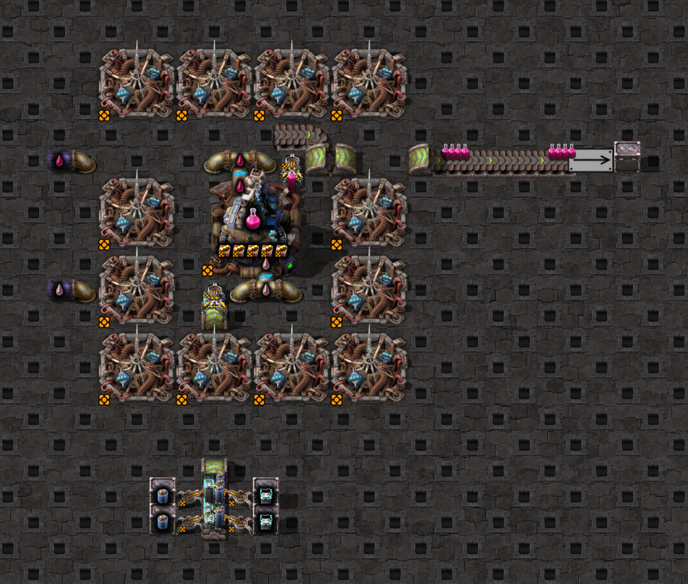

# Front pickup from an underground exit

Question: which exposed lane does an empty inserter collect from, and how does its first hand fill, when it stands
directly in front of an underground exit, and does flipping the inserter change its lane choice?
This fixture covers a northbound exit with the inserter directly north of it.

`scaffold.txt` adapts the different-item electromagnetic scaffold. Its upstream ingredient feed is turned north,
ending in a northbound turbo underground exit. The input inserter stands one tile north of the exit and drops into
the plant to its north. The base blueprint has `mirror: true`; the flipped case changes only the input inserter to
`mirror: false`. The probe verifies the actual `mirroring` property against the host-supplied expectation.
The ingredient drain is removed, so both lanes back up before the cell's inserters are placed in a staged start.
The base scaffold has accumulators on lane 1 and supercapacitors on lane 2, both in stacks of four.
The swapped case reverses only the four ingredient feeder filters and the input config lanes, using
`swapElectromagneticIngredientFeeds` from the shared fixture helpers. The flipped case keeps these swapped
ingredients and uses `flipFrontUndergroundInput` to change only the input inserter's mirror flag. Output disposal,
fluids, modules and beacons are retained. Use the powered staging save and research described in the [game guide](../../../../README.md).

## Scaffold screenshot



The committed base scaffold has the mirrored input inserter directly above the northbound exit, with accumulators
on lane 1 and supercapacitors on lane 2. Ingredient feeders are below the underground entrance. This is a layout
reference after warm-up, rather than the staged probe's initial state or a timing measurement.
See the [screenshot guide](../../../../README.md#scaffold-screenshots) for capture settings and regeneration.

## Observation and simulator comparison

Measured on 2026-10-18 in Factorio 2.1.21 with a legendary stack inserter, hand capacity 16, and a plant crafting
speed of 109.475. The probe clears machine inputs/output once, disables filters and circuit enable control, and
samples ticks 1–30 through the shared capture and belt snapshot helpers. It does not clear inventories each tick.

In all three cases, the first sample has an empty hand and two full four-item stacks on each half-tile exposed
line. The first grab at tick 2 removes the selected lane's downstream stack while leaving the other lane untouched.

| Mirrored | Lane 1 | Lane 2 | Selected lane | First game / simulator grab |
| --- | --- | --- | --- | --- |
| Yes | Accumulator | Supercapacitor | 2 | 4 supercapacitors |
| Yes | Supercapacitor | Accumulator | 2 | 4 accumulators |
| No | Supercapacitor | Accumulator | 1 | 4 supercapacitors |

The recipe stays unchanged throughout; between the last two cases, only the input inserter's mirroring changes.
All three first hands fill at offsets `0,1,2,3`, to counts `4,8,12,16`. Machine inventories remain empty and crafting progress stays zero through each hand, so ingredient
blocking or a pre-existing held item cannot explain the choice. Selecting lane 2 after swapping the items
distinguishes lane preference from fixed recipe order for the mirrored, backed-up orientation. Flipping the
inserter then switches selection from lane 2 to lane 1 with the same ingredients, confirming that mirroring changes
the preferred lane in this northbound front-exit setup.

The existing simulator matches these items and grab counts with `source.near_lane: 2` when mirrored,
`source.near_lane: 1` for the flipped case, `source.pickup_length: 0.5`, and `overrides.backed_up_belts: true`.
`config.json` holds the original mirrored case; the game test applies each scenario's lane and mirror changes.
Here `near_lane` selects the observed lane order: neither lane is geometrically nearer to this centered inserter. No engine change was needed.
The supplied clock target is not a verified default-clock throughput claim for this fixture.

Sidecar 0.10.0 captures `near_lane: 2` for the mirrored inserter and `near_lane: 1` when flipped, along with
`pickup_length: 0.5`, without an unclassified-pickup warning. The game regressions check both the recorder source
and the exported config, as well as the observed grabs. Classification requires a centered inserter at the exit's
open end, facing back into it. Sidecar 0.11.0 also supports the analogous centered downstream pickup from an
[underground entrance](../front-underground-entrance/README.md). Other unsupported inline pickups remain unclassified.

The original manual captures used Sidecar 0.9.1, which warned `inline` and omitted both settings. Omitting
`near_lane` makes the simulator select supercapacitors by recipe order in both ingredient arrangements, disagreeing
with the mirrored swapped case. The fixture config supplies the intended preference explicitly; Sidecar now
captures it automatically.

Other cardinal orientations, moving supply and repeated-hand timing remain separate cases. The four-speed sweep
below also covers the unmirrored inserter with the original different-item ingredients. Entrance measurements are documented in their
[own fixture](../front-underground-entrance/README.md).
The comparison measures filling offsets after the first grab, not general arm-arrival timing.

## Same item on both lanes

Measured on 2026-10-18 in Factorio 2.1.21 using the same probe, scaffold and initial conditions. The shared
`useAccumulatorsOnBothLanes` host helper changes only the two supercapacitor feeder filters to accumulators.
The unmirrored case changes only the input's mirror flag as well. No new blueprint or Lua probe is needed.

| Mirrored | Grab offsets | Hand counts | Selected lanes |
| --- | --- | --- | --- |
| No | `0,1,2,3` | `4,8,12,16` accumulators | `1,1,1,1` |
| Yes | `0,1,2,3` | `4,8,12,16` accumulators | `2,2,2,2` |

All grabs stay on the preferred side of the belt center. The other lane's stack IDs and positions remain
unchanged through each first full hand. Machine inventories remain empty and crafting progress stays zero.
The existing backed-up simulator matches, and Sidecar captures/exports the preference, half-tile reach and both
same-item lanes without warnings. No simulator behavior change is needed.

This fixture is physically backed up: the input inserter occupies the tile immediately beyond the exit, blocking
straight-through belt continuation. Setting a moving config flag would not make its actual game supply freely
flowing. A moving front-exit experiment needs a different physical arrangement; it has not been measured here.
The existing screenshot shows the same geometry with different lane ingredients. Raw same-item captures remain
under `work/belt-pickup/front-exit-same-item-unmirrored-backed-up-01/` and
`front-exit-same-item-mirrored-backed-up-01/`.

## Four-speed controls

The 2026-10-18 Factorio 2.1.21 sweep measures all four speeds, both mirroring states, original and swapped
ingredients, and the same item on both lanes: 24 independent first-hand captures. Each starts naturally saturated,
with two four-item stacks on each exposed half-tile line and an empty inserter. The probe asserts the actual belt
speed and underground partner, records every transport line at both endpoints, and retains the exact derived blueprint.
For normal speed, the upstream entrance moves one tile toward the observed exit and its former tile becomes a belt;
this reduces the tunnel from six to five tiles without moving the pickup, inserter, plant or ingredient feeders.

| Speed | Moving | Different-item grab offsets | Total pickup ticks | Same-item grab offsets | Same-item lane sequence |
| --- | --- | --- | --- | --- | --- |
| Turbo | false | `0,1,2,3` | 4 | `0,1,2,3` | Preferred four times |
| Express | false | `0,1,2,3` | 4 | `0,1,2,3` | Preferred four times |
| Fast | false | `0,1,2,5` | 6 | `0,1,2,3` | Preferred three times, then fallback |
| Normal | false | `0,1,2,9` | 10 | `0,1,2,3` | Preferred three times, then fallback |

The different-item patterns are unchanged by swapping ingredients or mirroring; mirroring still selects lane 1
unmirrored and lane 2 mirrored. These measurements expose a limitation in the current backed-up simulator:
continuous availability at every tick is too optimistic for a single matching lane on fast and normal undergrounds.
Same-item hand counts still match, but its preferred-lane-only explanation does not: the fourth native grab falls back.
The regressions assert these measured results and record the known model disagreement; they do not implement a fix.

This is finite refill, rather than incomplete saturation. In a representative fast capture, the selected exposed
line starts with stack IDs at positions 0 and 64 units (1/256 tile), while the paired underground's hidden line
starts with its head at 0 and follower at 64. The upstream exposed stack is grabbed at tick 2, the hidden head
arrives and is grabbed at tick 3, and the remaining exposed stack is grabbed at tick 4. The hidden follower advances
48, 32, 16, 0 over ticks 3–6 and can be grabbed only at tick 7. The equivalent normal capture waits until tick 11.
The untouched other lane stays stationary in different-item controls. A candidate first-hand fourth offset is
`1 + floor(64 / belt_speed_in_256ths_per_tick)` for this saturated geometry; it is not a complete repeated-hand model.

All 24 controls were captured twice. Final pairing/speed-checked evidence is local under
`work/belt-speed-coverage/front-final-entrance-02/front-exit-*`; the earlier sweep is `front-exit-01/`.
These are first-hand observations, not repeated-hand, complete phase, or generated-clock verification. Moving
front-exit supply still awaits the user's new scaffold; no moving exit result is claimed.

## Reproduce

From `clock-generator/`, with `.env` configured:

```bash
npm run test:game -- tests/game/mechanics/belt-pickup/front-underground-exit.game.test.ts -t 'swapped lanes'
npm run test:game -- tests/game/mechanics/belt-pickup/front-underground-exit.game.test.ts -t 'same-item'
npm test -- src/control-logic/inserter/modes/pickup/belt-lane-fallback.test.ts -t 'front underground exit'
```

The first command runs the mirrored and flipped cases with swapped ingredients, checks Sidecar capture, and
compares each actual simulator hand; it removes its temporary artifacts afterward. Use `-t 'flipped inserter'` for only the new case, or omit `-t`
for all 24 speed/ingredient/mirroring cases. The same-item command runs both mirroring states at all four speeds. The unit command runs the measured
hand regressions without Factorio. The game test composes
`probe.lua`; the scenario alone cannot be passed directly to `--lua`. Reports contain `initial` setup metadata and
`samples` with held quantities/items, exposed lane stacks/IDs, machine inventories and crafting progress.
Raw manual evidence remains local under `work/belt-pickup/front-exit-02/`, `work/belt-pickup/front-exit-03/`,
`work/belt-pickup/front-exit-swapped-01/`, and `work/belt-pickup/front-exit-flipped-01/` at the repository root.

To retain fresh captures instead of deleting temporary artifacts:

```bash
BELT_SPEED_CAPTURE_DIR=../work/belt-speed-coverage/front-exit-new \
  npm run test:game -- tests/game/mechanics/belt-pickup/front-underground-exit.game.test.ts
```

Use a new output directory for every run; existing captures are never overwritten.
