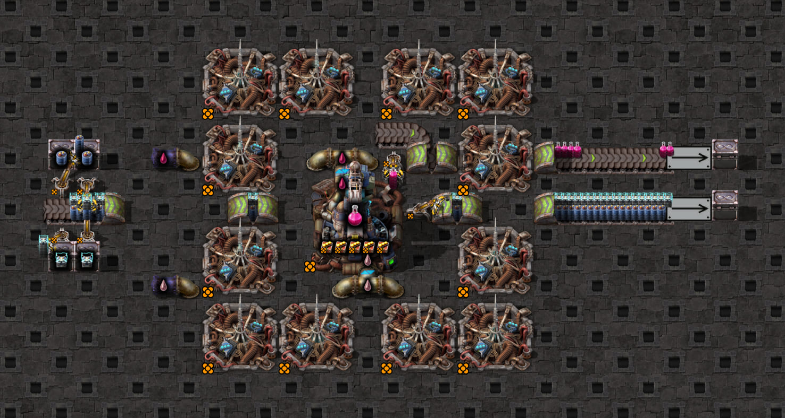
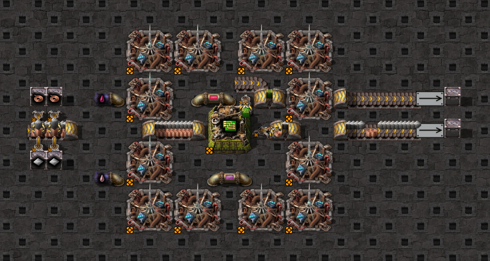

# Over-the-hood underground-exit pickup

The exact user-supplied 58-entity [scaffold](scaffold.txt) places the input one tile **upstream** of an eastbound
exit, facing east. Its hand reaches across the hood into the exposed outlet; its body leaves the eastward belt
continuation free. This is distinct from the existing downstream-facing [front exit](../front-underground-exit/README.md),
whose inserter blocks the continuation. It does not fill that separate continuously-moving coverage row.

## Layouts and native coverage

The supplied plant layout is unchanged at turbo/express/fast. Its seven-tile source pair cannot connect at
normal speed. The separate [compact normal control](compact-normal-scaffold.txt) uses a legendary 3×3 assembler
centered at `(-106.5,428.5)`, making electronic circuits from iron plates/copper cable. It preserves exit39,
input36 and output31; entrance21 moves two tiles east to `(-108.5,428.5)`, with ordinary belts bridging its former
tile and the next. The incompatible five-module plant loadout is removed; native compact crafting speed with
retained beacons is **70.765625**, versus **109.475** for the plant. The supplied test configs match these values.
The compact layout is tested at every speed, making the speed comparison independent of the destination change.

| Layout | Turbo | Express | Fast | Normal |
| --- | --- | --- | --- | --- |
| Exact plant geometry | 12 tested | 12 tested | 12 tested | Skipped: tunnel exceeds range |
| Compact geometry | 12 tested | 12 tested | 12 tested | 12 tested |

Each base set of 12 covers both mirroring states × moving/backed-up supply × original/swapped/same-item lanes:
**84 native first-hand controls**. An additional **174 moving controls** shift gate release through the remaining
aligned arrival phases: **258 controls total**, comprising 216 moving and 42 backed-up first hands. Both native
lanes cover all **2/8/4/8 phases** at turbo/express/fast/normal in each of the 42 layout/mirroring/content groups;
no extra delays were needed to obtain distinct first-grab phases. Plant and compact controls agree wherever both
layouts apply. Two earlier setup pilots are retained separately and do not add matrix coverage.

The target stays circuit-disabled through tick64 plus the selected release delay after **1,600 ticks of natural supply saturation**. No held or
belt stock is seeded, and machine inventories are cleared only once before observations. Guards check actual
pickup/drop targets, mirrored state, legendary hand16, recipe/hardware, ingredient pairs and tier prototypes,
two full four-item exposed stacks per lane, and native moving phase versus jammed stock. Compact output source
and product-drop targets are independently checked. The exact base's product output35 is an unpaired turning
stub; pairing checks deliberately cover the three ingredient pairs, not every decorative/product endpoint.

## Measured first hands

Offsets begin with the first grab; total ticks include both first and last grab ticks. These are the measured
aligned-lane phase at gate64. The additional phase sweep produces the moving families below; neither table
claims an absolute arm-arrival model.

| Speed | Moving | Different items: offsets | Total pickup ticks | Same item: offsets / total |
| --- | --- | --- | --- | --- |
| Turbo | true | `0,1,3,5` | 6 | `0,1,2,3` / 4 |
| Express | true | `0,1,3,6` | 7 | `0,1,2,3` / 4 |
| Fast | true | `0,1,2,6` | 7 | `0,1,2,3` / 4 |
| Normal | true | `0,1,4,12` | 13 | `0,1,2,3` / 4 |
| Turbo / express | false | `0,1,2,3` | 4 | `0,1,2,3` / 4 |
| Fast | false | `0,1,2,5` | 6 | `0,1,2,3` / 4 |
| Normal | false | `0,1,2,9` | 10 | `0,1,2,3` / 4 |

Unmirrored hands prefer **lane1**; mirrored hands prefer **lane2**, preserved by ingredient swaps. Hand
coordinates and native unique-ID withdrawal independently establish every selected lane, including same-item
fallback. Moving same-item sequences are `PPFP` at turbo/express, `PPPF` at fast, and `PPFF` at normal;
backed-up sequences are `PPPP` at turbo/express and `PPPF` at fast/normal (`P` preferred, `F` fallback).
All exposed lines are half a tile; source internal lines3/4 remain empty in these captures.

Across all aligned arrival phases, different-item hands have these measured families (`k` varies with phase):

| Speed | Moving | Different items: offsets | Total pickup ticks | Same item: offsets / total |
| --- | --- | --- | --- | --- |
| Turbo | true | `0,1,k,k+2`, k = 2–3 | 5–6 | `0,1,2,3` / 4 |
| Express | true | `0,1,k,k+d`, k = 2–4, d = 2–3 | 5–8 | `0,1,2,3` / 4 |
| Fast | true | `0,1,k,k+4`, k = 2–5 | 7–10 | `0,1,2,3` / 4 |
| Normal | true | `0,1,k,k+8`, k = 2–9 | 11–18 | `0,1,2,3` / 4 |

These families match the front-entrance controls. Across phases, same-item lane sequences are `PPFP`/`PPPF`
at turbo and `PPFP`/`PPPF`/`PPFF` at other speeds. Every observed first grab occurs two ticks after release;
that observation is separate from the replay, which starts from native stock and first-grab timing.

The independent moving-stock replay agrees on all **216 moving first hands**; the finite jammed
queue agrees on all **42 backed-up first hands**. Both condition on observed first grab/stock and do not prove
absolute approach timing. The production finite-refill model now matches these controls too.

New Sidecar captures export **supported / belt model 2**, `pickup_layout: "over-hood-exit"`, half-tile reach and
lane 1 unmirrored / lane 2 mirrored. Old captures keep their original **unsupported / inline** marker and require
recapture. Production pickup-mode comparisons now match held items, quantities and both exposed lanes in all
258 retained first hands; later observations are never fed back into the model.
The [base expectations](expectations.json) and [shifted-phase expectations](phase-expectations.json) keep native
timing, physical lane selection and replay results separate from that support boundary. Portable tests assert
actual first-grab phase coverage in both lanes, preventing duplicate phases from silently shrinking coverage.
These are isolated first hands. Separate [operating-clock checks](../../../../builds/README.md#over-the-hood-operating-clocks)
test repeated throughput and interruptions; a turbo recovery counterexample exposes different lane phases.

## Evidence and reproduction

The final base evidence and the 174 shifted controls (#245) are pinned in [expectations.json](expectations.json) and
[phase-expectations.json](phase-expectations.json); their raw captures, the two setup pilots and the original ungated
orientation pilot were not kept. The first native
matrix pass had 12 host-assertion failures in express moving cases: an incoming stack entered the exposed
window and was grabbed in the same tick, while the prior visible tail remained. The observer now tracks both
endpoints' real IDs. An independent audit confirms all **336 grabs** (including 170 incoming-stack witnesses).
All 84 retained base controls pass without recapturing native data or changing measured behavior. The combined
258-control replay passes with frozen expectations; an independent audit confirms all **1,032 grabs** have one
chosen-lane ID withdrawal and none from the opposite lane.

```bash
# Native matrix; use a fresh retained directory.
BELT_SPEED_CAPTURE_DIR=.scratch/belt-speed-coverage/over-hood-new npm run test:game -- tests/game/mechanics/belt-pickup/over-the-hood-underground-exit.game.test.ts

# Native shifted phases only; use another fresh directory.
OVER_HOOD_PHASES=1 BELT_SPEED_CAPTURE_DIR=.scratch/belt-speed-coverage/over-hood-phases-new npm run test:game -- tests/game/mechanics/belt-pickup/over-the-hood-underground-exit.game.test.ts -t 'release-'

# Combined replay of captures made locally, such as the two above: no Factorio process starts.
OVER_HOOD_PHASES=1 OVER_HOOD_REPLAY_DIR=.scratch/belt-speed-coverage/over-hood-new OVER_HOOD_PHASE_REPLAY_DIR=.scratch/belt-speed-coverage/over-hood-phases-new npm run test:game -- tests/game/mechanics/belt-pickup/over-the-hood-underground-exit.game.test.ts
```

In replay mode, a missing root for any selected case fails explicitly instead of starting Factorio.

## Portable production regressions

The [48 compact native clips](pickup-clips.json) retain the freshly captured first hands across all four
speeds, both mirroring states, moving/backed-up supply and original/swapped/same-item ingredients. They start
from observed full stock at tick 64 and supply only the native first-arrival boundary. Production predicts
later held items/quantities and exposed stock through the shared ordinary-pickup comparator.

```bash
npm test -- src/control-logic/inserter/modes/pickup/over-hood-exit.test.ts
```

Fresh capture validation additionally checks Sidecar model format 2 and its explicit layout; replaying older
reports preserves their original unsupported metadata. Classifier rotation checks cover all cardinal directions;
actual pickup timing here remains the measured eastbound orientation. Independent startup, repeated operating
throughput and generated-clock recovery remain final parity gates before release.

## Layout illustrations





These native Factorio screenshots show the baseline layouts after 600 warm-up ticks, with the clock disabled.
They illustrate geometry rather than the probe's exact starting stock. Refresh either registered case with
`npm run screenshots -- --case=over-the-hood-underground-exit` or
`npm run screenshots -- --case=over-the-hood-underground-exit/compact-normal`; the helper requires two free
Factorio process slots and compresses the native PNGs to JPEG without resizing.
