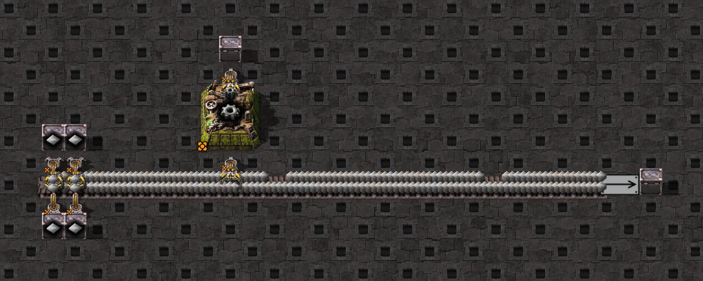
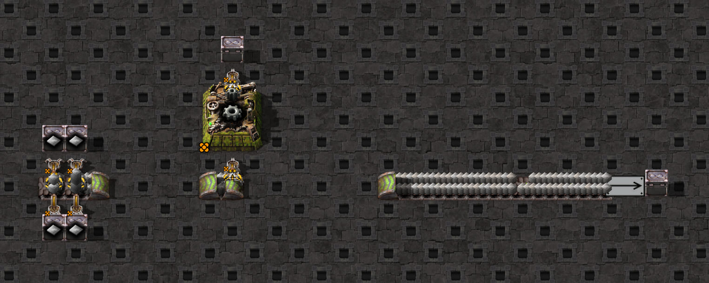
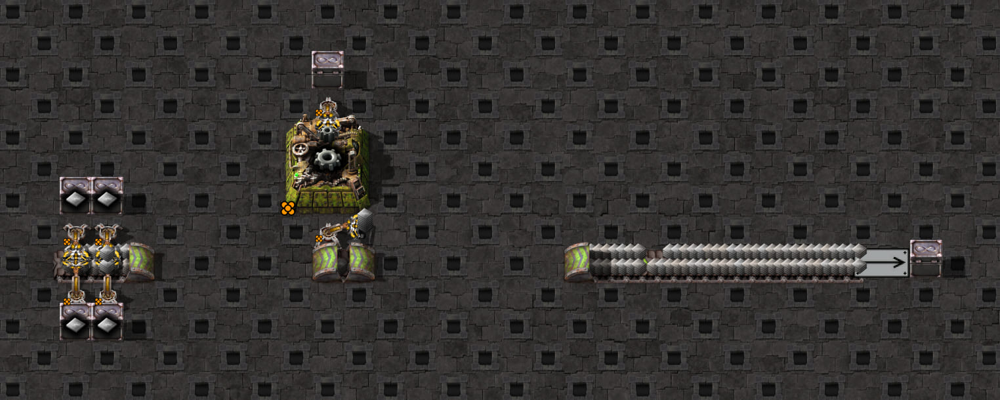

# Moving pickup with the same item on both lanes

These fixtures isolate an inserter taking iron plates from both lanes of a continuously moving turbo belt.
The measured rule is to take the upstream-most reachable stack on the near lane, falling back to the far lane when
the near lane has none. There is one grab total per tick and no fixed delay for changing lanes. With two saturated
lanes of four-item stacks, a hand of 16 filled at offsets `0,1,2,3` on all three geometries at turbo and express
speeds. The simulator uses this lane order and retains each lane's holes and partial stacks between hands.

Each scaffold has the same cell: a legendary assembling machine 3 making iron gears, a legendary stack inserter
bringing iron plates, and another taking gears into an infinity chest that removes them. Both hands hold 16.
The assembler has no modules: crafting speed 3.125, productivity 0. The ordinary config targets 6 gears/second.

Four feeder inserters fill the two lanes with iron plates in stacks of four. A loader and disposal infinity chest
drain the far end so the belt keeps moving. Feeder inserters and disposal infrastructure are outside the modeled
cell. Build on a powered editor surface with all inserter-capacity and belt-stack research, as with the other
scaffolds. There is no clock in these blueprints.

| Scaffold | Pickup | Matching config |
| --- | --- | --- |
| `straight-belt-scaffold.txt` | One exposed tile; control case | `straight-belt.json` |
| `underground-entrance-scaffold.txt` | Half an exposed tile | `config.json` |
| `underground-exit-scaffold.txt` | Half an exposed tile | `config.json` |

Input Inserter 2 stands beside the belt, with lane 1 nearest to it. Both configs explicitly specify the pickup
length and nearest lane. Output Inserter 1 takes gears from Machine 1 into Chest 1.

## Four-speed backfill

The [ordinary speed controls](../different-items/README.md#four-speed-backfill) extend moving/backed-up
same-item measurements to fast and normal belts on all three geometries. These use the electromagnetic
fixture with accumulators on both lanes and cleared destination inventories; the gear-clock build checks use
this fixture and iron plates. The distinction keeps isolated pickup evidence separate from operating throughput.
Normal-speed repeated hands can have gaps even with two matching lanes; the normal moving side-entrance also
has a measured lane-change arm-travel counterexample. The older turbo/express results below retain their scope.

## Capture pickup timing

From `clock-generator/`, with `.env` pointing at Factorio and the staging save:

```bash
npm run probe -- --fixture=same-item --geometry=underground-exit --out=../work/belt-pickup/same-item-run-01
```

The command composes shared Lua with this scenario and retains `probe.generated.lua`, `blueprint.txt`,
`config.json`, `recording.json` and `game/script-output/same-item-pickups.json` under the output directory.
The detailed report contains 1,200 ticks of held quantity/item, hand position, and each exposed lane's stack
positions, quantities and unique IDs. Use IDs to distinguish a taken stack from one that moved out of reach.
Discard its first 60 samples to get past any hand left over from warm-up. Empty lane `stacks` may serialize as `{}`.
The source `probe.lua` depends on host-composed shared helpers; do not pass it directly to `--lua`.

The probe clears the assembler's input and output every tick so its ingredient limit and output blockage cannot
stall the pickup. This deliberately interrupts production: use the probe to compare grab ticks and lane choices,
not gear throughput. Use the separate clock tests below for production and recovery.

Repeat with `--geometry=underground-entrance` or `--geometry=straight-belt`, using a new output directory.
The runner selects the matching config automatically. The command captures one starting stream phase. First-grab/arm arrival timing,
resumption after an interrupted partial hand, yellow/red speeds and backed-up supply are outside this probe's
verified two-lane scope.

```bash
npm run test:game -- tests/game/mechanics/belt-pickup/same-item-pickup-fixture.game.test.ts tests/game/builds/same-item-pickup-clock.game.test.ts
```

The twelve game checks validate the captured machine speed, both lanes' contents and stack sizes, pickup geometry,
matching config connections, and full hands on turbo and express belts with the inserter on either side. They replay
the near-first/far-fallback rule from each hand's observed first grab and remaining stacks, predicting every later
grab and lane snapshot. They also confirm that restricting the replay to the first lane misses underground hands.
The actual simulator's unrestricted hand must match every complete measured hand's grab offsets too.

The broader investigation covered 78 captures and 5,268 uninterrupted hands, including hands of 8/12/16,
interrupted windows and staggered turbo lanes, with no mismatch for the two-lane rule. Restricting the replay to
the first lane missed the timing of 1,078 hands; the simulator now implements the measured fallback.

Six additional game tests generate the current default clocks, check every baseline period (at least 60 per
scaffold), and test recovery after two ingredient cuts and a filled/restored output disposal chest. They require
exact output after a six-period recovery allowance, without resetting the clock or machine. All six passed with
the fallback implementation: 16 gears per 160 ticks (6/second), with a 26-tick input window on every geometry.
The underground window was 28 ticks before the correction; since the belt window-end trim the input window is
23 ticks, ending one rotation before the last return swing, re-recorded in the a2 controls. See
[the simulator findings](../../../../../../docs/simulator.md#picking-up-from-moving-belts-and-underground-endpoints)
for the general rules and measured scope; raw investigation captures and analysis remain local under
`work/same-item-pickup/investigation/`.

## Scaffold screenshots

Native Factorio views of the committed base blueprints, with entity info shown. These illustrate the layouts;
they are not probe samples or evidence of pickup timing. The ingredient drain is present in these base views.

Straight belt:



Underground entrance:



Underground exit:



See the [screenshot guide](../../../../README.md#scaffold-screenshots) for capture settings and regeneration.
