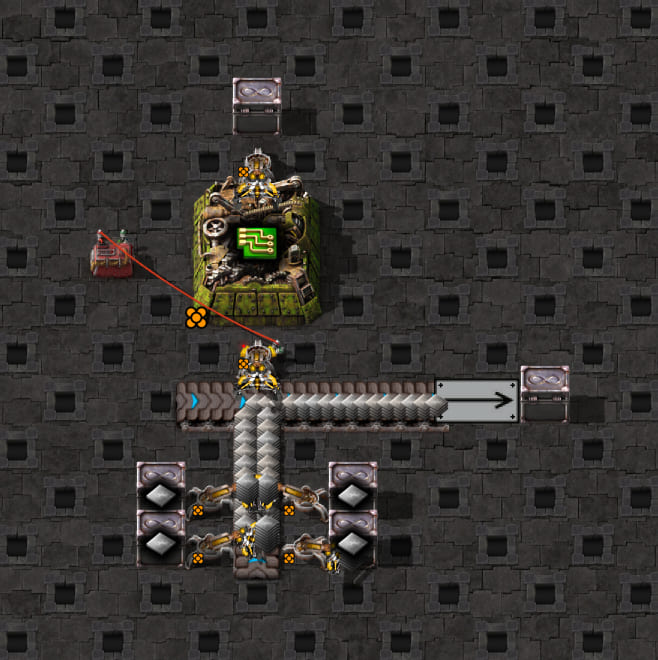

# Side-loading into a straight pickup tile: supply entry and merging

This paired experiment identifies why pickup geometry alone is insufficient. A straight belt's exposed line length does not establish
how much of that line a moving item stream traverses before an inserter can collect it. Items fed from the side
can enter near the downstream end, leaving most of the pickup tile empty even while the incoming lane is full.

## Layouts


`side-loaded-scaffold.txt` has an eastbound straight turbo pickup belt, an unmirrored legendary stack inserter
north of it, and an iron-plate feed arriving from the south. An empty west-side belt stub keeps the pickup tile's
shape straight. Two legendary feeder inserters keep the incoming right lane full; its left lane stays empty.
The output continues east into a drain loader and disposal chest, so the belt is free to move. The receiving
legendary assembler has the electronic-circuit recipe, but receives no copper cable and cannot start a craft.


`straight-through-scaffold.txt` rotates the same feed infrastructure west of the pickup and removes the empty
stub it replaces. The pickup tile, input inserter, machine, output drain and feeder capacity are retained.
The side-fed layout uses `config.json`, which describes a moving one-tile straight pickup with iron on physical
lane 2 and `pickup_supply: ["through", "side-inner"]`. The control test omits that supply override.
The screenshot settings are in the [game guide](../../../../README.md#scaffold-screenshots); these are layout
references rather than the probe's exact starting state or evidence of timing.

## Setup and measurement

Measured on 2026-10-18 in Factorio 2.1.21 with legendary stack inserters, hand capacity 16 and four-item turbo
belt stacks. An empty wired constant combinator holds the machine input disabled during 1,200 warm-up ticks.
The probe verifies an empty hand and a straight eastbound pickup tile, disables circuit enable control/filters,
sets hand capacity 16 and clears machine inventories once. It observes ticks 1–30 using the shared capture and
belt snapshot helpers. It does not insert items, modify feeder hands or refill belts through Lua.

Generic staged saturation is deliberately not used: the side-fed pickup tile is never populated along its whole
line. Instead, each sample verifies that the incoming right lane contains 16 items and cannot accept another
stack at its back. This condition holds through both first hands. Machine inputs/output stay empty and crafting
progress stays zero throughout them, excluding destination blocking and upstream feeder starvation as explanations.

| Feed into pickup | Exposed length, each lane | Initial lane-2 stacks | Game grab offsets | Legacy through assumption |
| --- | --- | --- | --- | --- |
| Straight through from west | 1 tile | 4 stacks of 4 | `0,1,2,3` | `0,1,2,3` |
| Side-loaded from south | 1 tile | 1 stack of 4 | `0,2,4,6` | `0,1,2,3` |

Both hands collect 4, 8, 12 and 16 iron plates. The side-fed hand grabs each arriving stack near the pickup tile's
downstream end. The single initial stack is at transport-line position `0.01171875` at probe tick 1; the rest of
that lane is empty. The straight-through control starts at positions `0,0.25,0.5,0.75` and matches the current model.
The incoming lane remains full in both layouts while these differences develop on the pickup tile.

## General finding

**Pickup depends on the stacks actually traversing the reachable part of a lane. A full incoming belt does not
imply a full pickup tile.** Side-loading changes supply, while the inserter's reach and lane preference stay the same.

The extended experiment derives all variants from the photographed side-loaded scaffold. It changes the incoming
lane, reflects or rotates the whole layout, changes belt speed, or removes only the ingredient drain loader.
It leaves the input disabled for 16 observation ticks after warm-up, then releases the existing circuit gate.
A second turbo phase releases it after tick 17. No stacks are placed or feeder hands modified by Lua. All
populated incoming lanes remain full at every sample through the first completed hand, and machine inventories
and crafting progress stay empty/zero. Both receiving transport lines still report length 1.

For the eastbound receiving belt with feed arriving from the south:

- Both incoming lanes feed **receiving lane 2**. They do not become two receiving lanes.
- Incoming lane 2 is on the **inside of the turn** and enters close to the receiving lane's downstream end.
- Incoming lane 1 is on the **outside of the turn** and enters farther upstream.
- Reflecting the layout so feed arrives from the north swaps those incoming lane numbers and feeds receiving
  lane 1. Rotating the inner-feed layout through the other three cardinal directions preserves its timing.

The inner/outer names describe the incoming stream's turn, independently of the inserter's preferred lane.
The inserter in these experiments takes from the sole populated receiving lane; its preferred lane is empty.

### One incoming moving lane

Transport-line positions decrease toward zero at the downstream end. Tracking the same stack ID across the
junction establishes these effective transfer boundaries, in tiles from that end:

| Incoming stream | Boundary `E` | Approximate supplied span of the receiving tile |
| --- | --- | --- |
| Inside of turn | `67/256 = 0.26171875` | Downstream quarter |
| Outside of turn | `188/256 = 0.734375` | Downstream three quarters |

For an unblocked crossing, `new_position = E - (speed - previous_incoming_position)`: unused motion after
crossing the incoming line's end is carried into the receiving line. These constants describe the measured
straight-tile junction in Factorio 2.1.21, not new values for physical `pickup_length`.

A simple independent replay maintains quarter-tile stack spacing, advances at belt speed, restricts the train
to `0 <= position < E`, and removes the upstream-most available stack once per tick. Phase is inferred from the
first sample **before pickup**; only the first attempt tick is taken from the observed hand. That replay matches
every sampled receiving-stack position and hand count through all 15 single-lane moving first hands. It uses no
fixed pickup delay or belt-specific hand offsets.

These are the measured grab offsets for the gate released after tick 16; they are phase-dependent examples:

| Belt speed | Outer stream only | Inner stream only | Both incoming lanes |
| --- | --- | --- | --- |
| Turbo | `0,1,2,4` | `0,2,4,6` | `0,1,2,3` |
| Express | `0,1,2,4` | `0,1,4,6` | `0,1,2,3` |
| Fast | `0,1,2,4` | `0,4,8,12` | `0,1,2,3` |
| Transport | `0,1,2,4` | `0,4,12,20` | `0,1,2,3` |

The reflected turbo layout gives the same inner/outer patterns. The three rotated turbo inner-feed layouts
retain `0,2,4,6`. Releasing the turbo gate one tick later changes **both** single-stream patterns to `0,1,3,5`;
the two-stream hand remains `0,1,2,3`. Thus even the inner stream does not always require two ticks between grabs.

### Two incoming moving lanes

Both streams compete for space on **one** receiving lane. Before pickup, the outer stream keeps flowing and
the leading inner stack ID stays stationary for all 16 observation ticks. After the inserter creates holes,
that waiting inner stack leaves its input queue. Its ID appears on the receiving lane at turbo/express speed
and in the reflected turbo case; at fast/transport speed its departure coincides with a four-item hand increase
between observations. The four consecutive grabs therefore do not establish two independent supplies or a
globally preferred incoming lane. They demonstrate a merge whose available space changes when the inserter withdraws stacks.

In the express merge, an inner stack appears at `0.44921875`, upstream of its free-flow boundary `0.26171875`.
A fixed supplied span alone cannot describe this case: collision and backpressure affect placement, arrivals and phase.
Do not add the two streams' throughput or treat the outer stream as an unconditional priority rule. Different
items in the merging streams and repeated hands are covered by the controlled follow-ups below. Additional
rear/side feeds and unequal speeds remain untested.

### Repeated two-stream turbo test

This is one controlled follow-up case, measured in Factorio 2.1.21: turbo belts, iron plates on both incoming
lanes, four-item belt stacks, the same eastbound straight pickup, an unmirrored legendary stack inserter with
hand capacity 16, and the drain retained. The fixture generator clones the original feeders onto the opposite
side of the incoming belt; no additional blueprint or copied probe is needed. The input gate releases after
16 observed ticks, and capture continues through tick 512.

The probe clears **only the destination machine inventories, after observation**, to prevent its iron insertion
limit from stopping further hands. It does not modify held items, transport-line contents, feeders or crafting
progress after setup. No copper cable is supplied, so the machine never crafts. Incoming/receiving stacks and
one downstream tile are observed by the shared `pickup.lanes` helper. This setup isolates merge/refill behavior;
it is not a generated-clock throughput test for an operating machine.

Both incoming lanes stay full at 16 items throughout all 512 samples. The 45 completed hands each take four
consecutive grabs (`0,1,2,3`), for 180 grabs / 720 items. Every hand contains three stacks from incoming lane 1
(the outer stream) and one from incoming lane 2 (the inner stream), but their order changes:

| Hand | First grab tick | Incoming lanes supplying the four grabs |
| --- | --- | --- |
| First | 18 | `1,1,1,2` |
| Second | 29 | `1,1,2,1` |
| Third | 40 | `1,1,1,2` |

The `3:1` count is an observation of this setup, not a fixed priority or allocation rule. The outer stream
enters 256 stacks during the 511 replayed transitions; the inner stream enters 157 and waits on 197 other
attempts. Some stacks pass the pickup instead of being grabbed, so entrance throughput and inserter selection
are different quantities.

A candidate replay using shared receiving stock reproduces **every stack ID and position on the pickup and
next tile, both incoming queues, and every hand count over all 511 transitions**. Its 610 entry attempts yield
413 transfers and all 180 observed grabs. Initial stock is seeded from the first observation. Incoming refill
**identities** and arm arrival/drop ticks are observations; refill positions, acceptance/rejection, stock movement,
subsequent grabs and their identities are predicted. This does not independently predict arm arrival timing.

The candidate rule, in 1/256-tile integer units, is:

1. Both streams consider the receiving stock from the preceding tick. Start at entry 188 (outer) or 67 (inner),
   carrying the incoming stack's residual distance. If downstream stock prevents a 64-unit gap, shift the entry
   upstream to the next legal position. In this replay, a shift of up to one stack spacing is allowed; otherwise
   the incoming queue waits.
2. Existing receiving/downstream stock advances by up to 32 units. A follower moves less if necessary to restore
   a 64-unit gap behind the preceding stack. Newly accepted stacks join with the motion left after crossing.
3. Apply the existing pickup choice: take the upstream-most reachable stack, at most one per tick.

New arrivals can leave a **temporary gap shorter than 64 units to an upstream follower**. At tick 24 the
receiving positions are `35,92,156`, including a 57-unit gap; tick 25 becomes `3,67,131`. The first stack moves
32 units, while its followers move only 25. Rejecting every entry unless it immediately preserves 64-unit
spacing would miss this accepted arrival and its later effect.

Other measured examples are entry 131 for the inner stream when the preceding receiving stock is `3,67`,
entry 195 for the outer stream behind `3,67,131`, and a waiting inner queue in that latter state. These are
covered by small offline regressions, alongside the single live repeated-hand case.

**Simulator impact:** this strengthens the case for shared stock, incoming queues and explicit update order.
The current through-stream approximation happens to match all hand offsets here, but it does not describe
which streams or stacks supply them. Hand counts alone would hide that modeling error. Production merge
support and Sidecar's `merge` warning are unchanged.

The replay is a candidate, not a general Factorio contract. This one case does not establish the exact
insertion-window boundary, simultaneous-entry arbitration, other speeds, different items, mirrored layouts or
backed-up behavior. In particular, 64 units is a sufficient entry-shift limit for this capture; the experiment
has not distinguished it from every larger possible limit. The express follow-up below falsifies this candidate.

### Repeated turbo test with release at tick 17

Keep the two-stream turbo setup unchanged and release the input gate after tick 17 instead of tick 16.
The original one-spacing entry-shift candidate fails at tick 20: preceding receiving positions `28,92` push
the inner stream's entry from 67 to 156. The game accepts this 89-unit shift, leaving the new stack at 124
after movement; the original candidate rejects it. Both incoming lanes remain full throughout 512 samples.

All 45 hands still take four consecutive grabs, now starting at tick 19 and completing at tick 22, with later
hands 11 ticks apart. Actual withdrawals remain 135 outer and 45 inner stacks. The first three hands use
`1,1,2,1`, `1,1,1,2`, and `1,1,2,1` respectively. The merge admits 414 stacks over 609 entry attempts.

A revised **turbo-only candidate** permits entry shifts strictly below 96 units, preserving the existing
stock movement and update order. It matches every queue, receiving/downstream stack ID and position, and hand
count across all 511 transitions in both release-phase captures. The observations constrain an inclusive
shift cap to 89–95 units; at this stage they do not uniquely establish the cutoff within that range. The
controlled calibration below resolves the integer boundary. No general following-clearance threshold is
established by these turbo captures. This is an experimental replay, not production support.

The original candidate is retained so its failure remains reproducible. The raw release-17 capture and replay
are under `work/belt-pickup/two-stream-side-loading-turbo-release17-01/`. Further investigation focuses on
turbo belts; other speeds are deferred, with the express evidence below retained for reference.

### Turbo entry-window cutoff calibration

In Factorio 2.1.21, the inner stream **accepts every tested integer shift from 89 through 95 units and waits
at 96 units**, where one unit is 1/256 tile. Controls at 95 and 96 with the outer stream absent give the same
answers. Thus rejection at 96 does not require a competing outer arrival. At this integer resolution, the
candidate's strict `shift < 96` window matches the measured cutoff without another numerical adjustment.

This is a separate, explicitly seeded calibration, not a naturally supplied clock test. The turbo geometry
is unchanged, but `entry-window-probe.lua` disables all inserters, clears belt/loader transport lines, and
uses native `LuaTransportLine.insert_at` once to establish the starting state. It does not change any held
stack or researched technology. Each incoming stream starts with four four-item iron stacks at positions
`0,64,128,192`; the outer stream is empty in the two absence controls. Receiving stock starts at
`shift - 61, shift + 3`, exactly 64 units apart. Those blockers push the inner entry from 67 to `67 + shift`.
The drain remains open, and subsequent ticks contain only native movement and transfer, with no refill.

Native insertion on the receiving line in this setup advances items by a 32-unit turbo step before the
initial observation. The probe compensates its insertion coordinates and asserts the **observed** positions
before accepting a run. The report records this offset, the seeded-state marker, requested shift and stream
presence. This setup detail is not part of the proposed supply rule.

| Requested shift | Receiving positions before transfer | Inner transfer on first tick |
| --- | --- | --- |
| 89 | `28,92` | Accepted; observed at 124 after movement |
| 90–94 | `29,93` through `33,97` | All accepted; observed at 125–129 |
| 95 | `34,98` | Accepted; observed at 130 |
| 96 | `35,99` | Waits; the same stack ID remains at the incoming front |

With both streams present, the outer lead transfers to 156 in every case. Accepted inner shifts can therefore
leave simultaneous arrivals only 26 units apart. For shift 95, the receiving positions after the first tick
are `2,66,130,156`; on the next tick the leading stack leaves and the others are `34,98,156`. The trailing
stack **waits**, rather than moving upstream to force a 64-unit gap immediately. On the following tick it
moves from 156 to 130 and normal spacing is restored. The experimental movement rule now clamps forward
movement to between zero and the belt speed, preserving compressed gaps until they can open naturally.

Ten targeted game regressions cover all eight integer shifts and both outer-absent boundary controls. They
check initial state, transfer IDs/positions and movement of existing receiving stacks through four ticks;
withdrawals stay disabled. The repeated-hand controls remain separate. Sub-unit precision, nonzero incoming
residuals at this boundary, other merge geometries and arbitrary following clearances are not established.
Production merge support and Sidecar's warning are unchanged.

Validated raw captures are locally under `work/belt-pickup/`, in
`turbo-entry-window-89-outer-04`, `turbo-entry-window-90-outer-01`, `turbo-entry-window-95-outer-01`,
`turbo-entry-window-96-outer-01`, and `turbo-entry-window-96-inner-only-01`. Earlier setup attempts are not
boundary evidence. The permanent game matrix independently reproduces the complete integer range.

### Pause and resume the turbo pickup

With the original tick-16 release, disable the input after observing tick 124, when its hand is empty, and
re-enable it after tick 156. Leave both full incoming lanes and the outlet drain running. The probe changes
only the input's existing circuit gate and continues clearing destination inventories after observation.
Samples precede each gate change: ticks 125–156 show the disabled input, and tick 157 shows it enabled.

The revised turbo candidate matches all 511 transitions, including incoming queues and receiving/downstream
stock throughout the pause. Pickup resumes at tick 158 and fills the next hand at 161, again with four
consecutive grabs. There are 42 completed hands plus three grabs of the final hand at the capture boundary:
171 observed grabs, comprising 129 outer and 42 inner stacks. All completed hands retain the observed `3:1`
mix. The capture contains 404 transfers over 620 entry attempts. Arm arrival/drop ticks remain observed
inputs to the replay; this does not independently validate circuit wake-up or arm movement timing.

Raw evidence is under `work/belt-pickup/two-stream-side-loading-turbo-pause-01/`. This passes the pause/resume
check without a production simulator or Sidecar change.

### Block and release the turbo outlet

Remove only the drain loader after tick 124 and recreate it after tick 188, keeping pickup and both incoming
feeds enabled. Observe all three downstream belt tiles, rather than just the first, so their finite stock
and closed end are part of the replay. The removed loader's internal contents are outside these observed
belts; no observed belt stacks or inserter-held items are removed by the probe.

The downstream belt fills by tick 128. Its 12 stacks stop at positions `-768,-704,...,-64` relative to the
pickup line's end and remain there through tick 188. Pickup still opens gaps on the receiving tile, so merge
arrivals must respect stationary downstream stock. On tick 132, both streams join: the receiving positions
become `0,64,128,192`, rather than allowing the new outer stack to overlap the new inner stack.

Extending the experimental replay with a finite closed end, downstream clearance for new arrivals, spacing
between simultaneous arrivals, and an entry strictly inside the receiving tile reproduces all 511 transitions.
The restored outlet is open in the tick-189 observation; stock then drains and returns to moving operation.
All 45 hands still fill in four consecutive grabs, totaling 135 outer and 45 inner stacks. There are 386
transfers over 637 entry attempts. The production simulator's saturated backed-up approximation does not model
this finite stock or the transition; Sidecar's unsupported-merge warning remains necessary.

Raw evidence is under `work/belt-pickup/two-stream-side-loading-turbo-outlet-01/`. This tests one blocked-output
length and release time, not arbitrary downstream networks or all insertion clearances.

### Reflect the repeated turbo layout

Reflect the complete layout north/south, keeping the receiving belt eastbound and release at tick 16. This
reverses the physical receiving lane and which incoming lane is inner or outer; it is not a toggle of only
the inserter's mirroring flag. The same candidate predicts all 511 transitions after this lane remapping,
without changing its entry boundaries or timing constants.

The 45 hands again fill in four consecutive grabs, starting at tick 18. Incoming lane 2 now supplies 135
outer-stream stacks and lane 1 supplies 45 inner-stream stacks. The first two hands are `2,2,2,1` and
`2,2,1,2`. There are 413 transfers over 610 attempts, matching the original layout's counts. This controls
for physical lane numbering in this reflected geometry; other repeated-merge cardinal rotations remain
unmeasured. Raw evidence is under `work/belt-pickup/two-stream-side-loading-turbo-mirrored-01/`.

### Different items on the two turbo streams

Supply iron plates on the outer incoming lane and copper cable on the inner lane, then repeat with the items
swapped. Both are electronic-circuit ingredients. Keep the same four-item stacks, gate release at 16, full
feeds, running drain and destination cleanup. The machine never crafts: after each drop its inventory is
cleared before another hand arrives. This isolates selection and merge timing with both ingredients eligible;
it is not a throughput or recipe-demand test for an operating machine.

Both captures match all 511 transitions with unchanged merge entry constants and movement. The replay carries
each stream's item identity, selects the upstream-most reachable stack for an empty hand, and then takes only
that same item until the hand is full. External refill IDs remain observed inputs; their item is predicted
from the incoming stream, not taken from future receiving-stock observations.

Each capture has 41 completed hands plus three grabs of the final hand: 167 grabs, all from the outer stream,
with completed-hand offsets `0,1,2,4`. The first hand starts at tick 18 and fills at 22; subsequent hands start
12 ticks apart. Inner-stream stacks do enter the receiving lane but pass the pickup. There are 421 transfers
over 603 entry attempts in either arrangement. Swapping ingredients changes the held item from iron to cable
without changing these timings, so the selection is not fixed to iron or its recipe position in this setup.

This is evidence for separating item-independent supply placement from held-item pickup selection. It also
demonstrates an outer-stream-only selection pattern with this initial phase and repeated empty destination;
it does not establish a general starvation rule under normal machine demand. Raw evidence is under
`work/belt-pickup/two-stream-side-loading-turbo-mixed-01/` and
`work/belt-pickup/two-stream-side-loading-turbo-mixed-swapped-01/`.

### Repeated two-stream express test



The [screenshot scaffold](two-stream-express-scaffold.txt) is the exact generated blueprint used for the express
capture. The native Factorio screenshot shows the layout after the screenshot script's standard 600-tick warmup;
it is not a snapshot of either mismatch tick. The two feeder pairs supply both incoming lanes, and the outlet
loader drains the receiving belt. The screenshot script compresses its native PNG to JPEG for documentation.

Repeat the turbo setup above with only the belts and drain loader changed to express speed (24 units per
tick). Geometry, feeder arrangement, items, stack sizes, inserter quality, gate timing, destination cleanup
and the 512-tick capture remain the same. Both incoming lanes again stay full throughout the capture.

**The unchanged candidate does not hold at express speed.** It matches the first 17 transitions, then
diverges at tick 19. Positions below use 1/256-tile integer units:

| Transition | Observed receiving positions before update | Inner-stream decision |
| --- | --- | --- |
| Tick 19 | `11,75` | The game accepts an entry at 139, observed at 115 after 24 units of movement. The candidate rejects it: shifting from 67 to 139 requires 72 units, exceeding its 64-unit cap. |
| Tick 27 | `3,68,132` | The candidate accepts entry at 67, but the game keeps the incoming stack waiting. The existing upstream follower is only one unit away, so increasing the entry-shift cap alone cannot explain both decisions. |

These observations reject the candidate's entry acceptance rule. They do not establish a replacement entry
window or a precise minimum clearance to an upstream follower. The next refinement needs to explain both
captures' transfer decisions and stock positions before becoming a general simulator rule.

All 45 hands still fill in four consecutive grabs (`0,1,2,3`), totaling 180 stacks / 720 items. The candidate
even predicts every held count correctly despite diverging on incoming queues, receiving stock and identities.
Actual withdrawals, attributed independently by stack ID conservation, include 119 outer-stream stacks and
61 inner-stream stacks, compared with turbo's 135 and 45. The first express hand uses incoming lanes
`1,1,2,2`; the candidate predicts `1,1,2,1`. Thus neither the turbo `3:1` mix nor agreement on hand counts is
sufficient evidence of correct merge timing.

The express regression preserves these counterexamples explicitly; it does not retune the candidate to fit
this capture. Production simulator behavior and Sidecar's unsupported-merge warning remain unchanged.

### Backed-up supply

Removing only the drain loader makes stacks stationary before pickup. All three turbo variants (inner, outer,
and both streams) fill their first hand at `0,1,2,3`. The inner-only receiving lane initially holds three stacks
at `0,0.25,0.5`; the others hold four at `0,0.25,0.5,0.75`. Accumulation lets the inner-only lane extend upstream
of its free-flow entry boundary. Consequently the moving supplied-span restriction must not be applied unchanged
to backed-up stock. These first hands agree with the existing backed-up pickup timing; they do not establish
unlimited stock or repeated-hand throughput.

## Simulator and capture model

The engine now implements the supported turbo two-stream case. Earlier candidate descriptions above preserve
how the rule was derived; their statements about production support describe that investigation stage.
The general pickup rules stay the same:

1. Check the preferred receiving lane first, then the other lane when it can supply the held item.
2. Take the upstream-most reachable eligible stack, at most one per tick; finish collecting only that item.
3. Let belt supply determine which stacks are present. Keep geometry separate from supply motion.

Single streams still use per-lane `source.pickup_supply` profiles (`through`, `side-inner`, `side-outer`).
A supported two-stream pickup uses `source.pickup_merge` instead:

```json
"source": {
  "type": "belt", "id": 1, "near_lane": 1, "pickup_length": 1,
  "pickup_merge": {
    "lane": 2,
    "outer": { "ingredient": "iron-plate", "stack_size": 4 },
    "inner": { "ingredient": "copper-cable", "stack_size": 4 },
    "downstream_tiles": 3,
    "outlet": "open"
  }
}
```

This supports two full four-item lanes of one perpendicular turbo belt feeding one straight turbo receiving
lane. Both streams may carry the same item or different items. The belt's receiving-lane `ingredient` names
the outer item, while merge metadata supplies both actual ingredients. The other receiving lane is empty,
and one pickup inserter is supported. Unsupported speeds, geometry, stack sizes, extra receiving supplies,
shared pickups or a simultaneous `pickup_supply` are rejected by config validation.

The production `BeltPickupMerge` owns incoming queues and shared receiving/downstream stock. It applies the
measured strict 96-unit entry window, finite end/backpressure, zero-to-32-unit forward movement and temporary
compression, then lets the pickup mode withdraw a stack. Holes, partial stacks and queues survive closed
pickup windows and control replacement. Supply advances every simulation tick, and stock/queues participate
in repeat-state keys without absolute IDs or ticks. Ordinary configs assume a canonical outer-train phase;
verification can seed observed stock once. Observed arm start/drop ticks are still inputs to the isolated
pickup comparisons, not a claim of independently predicting arm timing.

`downstream_tiles` counts only straight tiles after the pickup, excluding its tile and any loader. An `open`
outlet drains freely; `closed` is a physical belt end. Explicit Backed up supply closes the outlet as well.
An outlet refusal propagates through finite stock; it does not instantly replace that stock with an infinite
backed-up train. Single-stream backed-up availability remains unchanged.

Sidecar 0.11.0 captures this merge only when both streams come from the same straight, same-speed turbo input
with four-item stacks and an unambiguous straight upstream path. It follows the downstream path to a closed
belt end or a turbo loader feeding an unfiltered disposal infinity chest. Junctions, cycles, finite output
chests, additional droppers/takers and unsupported endpoints retain a `merge` warning. Ambiguous single feeds
retain `supply-unknown`. A capture remains a saturated-input assumption, not proof of future supply rate.

The seven repeated turbo controls compare **the production pickup mode and supply** with every observed
queue, stack ID, position, held count and item across 511 transitions per capture. Only the initial stock,
external refill identities and arm starts/drops are supplied observations. The ten cutoff cases additionally
compare production movement and native transfers through four ticks without refilling. The independent
candidate replay remains available as a separate reference. The generated same-item gear clock holds all
60 recorded periods in `tests/game/builds/turbo-merge-clock.game.test.ts`.

An additional operating-machine check confirms a real starvation case for the mixed streams. With iron on
the outer stream and cable on the inner, enable the empty input after warm-up and leave machine inventories
untouched. The machine ends with 16 iron, no cable and no products over 1,200 ticks. Once iron is blocked,
there are no new pickup gaps to admit cable. The simulator reproduces the stall and reports a repeating
preparation state instead of timing out. Raw evidence is under
`work/belt-pickup/turbo-merge-operating-mixed-02/`; the earlier attempt with its circuit gate still closed is
not evidence of this failure. This capture does not claim every mixed merge or initial phase must starve.

Other speeds, stack sizes, sparse streams, additional feeds and sub-unit entry precision
remain outside the production merge model; the four-speed backfill below records additional native evidence. Keep the unsupported warning until those cases are investigated.

## Reproduce

From `clock-generator/`, with the [game setup](../../../../README.md#setup):

```bash
npm run test:game -- tests/game/mechanics/belt-pickup/side-loaded-straight.game.test.ts
npm run test:game -- tests/game/mechanics/belt-pickup/side-loaded-entry.game.test.ts
npm run screenshots -- --case=side-loaded-straight
npm run screenshots -- --case=side-loaded-straight/control
npm run screenshots -- --case=side-loaded-straight/two-stream-express
```

The paired game test checks both layouts, incoming fullness, initial source stacks, hand counts, machine
state, Sidecar capture/export and simulator agreement. It composes `probe.lua`, then removes temporary
recordings. The 24-case entry matrix derives its variants in `side-loaded-entry.game.test.ts` and uses the same probe with
a delayed gate release and 96 observation ticks. It checks incoming fullness, transfer IDs/boundaries, the independent
single-stream replay, merge blocking/release, stationary backed-up stock and first-hand counts. Reports retain the
shared `front-pickup.json` schema with `initial` metadata and `samples`, adding incoming `feed` counts/fullness
and detailed stacks to every sample. Raw manual captures remain locally under
`work/belt-pickup/side-loaded-single-lane-moving-01/` and `straight-through-single-lane-moving-01/`.

Extended raw captures are under `work/belt-pickup/side-loading-entry-investigation/`, with one subdirectory per
variant containing its parameters, generated blueprint/config, probe, recording and detailed samples.

Run one repeated merge case at a time (the remaining entry cases are skipped):

```bash
npm run test:game -- tests/game/mechanics/belt-pickup/side-loaded-entry.game.test.ts -t 'turbo-south-both-repeated-merge$'
npm run test:game -- tests/game/mechanics/belt-pickup/side-loaded-entry.game.test.ts -t turbo-south-both-repeated-merge-release17
npm run test:game -- tests/game/mechanics/belt-pickup/side-loaded-entry.game.test.ts -t turbo-south-both-repeated-merge-pause
npm run test:game -- tests/game/mechanics/belt-pickup/side-loaded-entry.game.test.ts -t turbo-south-both-repeated-merge-outlet
npm run test:game -- tests/game/mechanics/belt-pickup/side-loaded-entry.game.test.ts -t turbo-north-both-repeated-merge
npm run test:game -- tests/game/mechanics/belt-pickup/side-loaded-entry.game.test.ts -t 'turbo-south-both-repeated-merge-mixed$'
npm run test:game -- tests/game/mechanics/belt-pickup/side-loaded-entry.game.test.ts -t turbo-south-both-repeated-merge-mixed-swapped
npm run test:game -- tests/game/mechanics/belt-pickup/side-loaded-entry.game.test.ts -t 'turbo merge entry window'
npm run test:game -- tests/game/mechanics/belt-pickup/side-loaded-entry.game.test.ts -t express-south-both-repeated-merge
npm test -- tests/game/mechanics/belt-pickup/two-stream-merge-replay.test.ts
```

Raw captures, parameters, generated blueprints/configs and exploratory replays remain locally under
`work/belt-pickup/two-stream-side-loading-turbo-01/` and
`work/belt-pickup/two-stream-side-loading-express-01/`. The permanent candidate replay is
`two-stream-merge-replay.ts` beside the game test. Existing 24-case entry tests retain their original bounds;
the original turbo and express repeated-hand cases are the 25th and 26th named entry tests. The six subsequent
turbo controls (release-17, pause, outlet, reflection and both mixed-item arrangements) bring this file to 32
named cases; ten seeded cutoff calibrations bring the total to 42. Use an exact name or an end anchor when selecting only one; the original turbo name is also a
prefix of several follow-ups. Those original42 cases remain regression controls; the four-speed backfill below adds the missing combinations.

## Four-speed backfill

The speed variants reuse these layouts and change only transport prototypes. Normal transport belts are
named `yellow` in the entry-test identifiers. Each capture asserts the actual prototype speed, full
incoming stack-four supply, empty unused lanes and native hand counts. Existing single-stream profiles
are compared with the simulator; slower two-stream merges retain unsupported capture warnings.

The 180 natural entry cases cover backed-up supply, reflection, the other three inner-stream rotations, each tick offset in the
quarter-tile gate-release cycle, repeated hands, both mixed-item arrangements, pause/resume and outlet
block/release. Operating-machine controls leave inventories alone; repeated timing controls clear only
the destination inventories after observing each tick. Removing the ingredient drain supplies the
backed-up variants. A fixed pause at tick 124 can interrupt a partial hand at slower speeds, so timings
spanning that pause include the intentional circuit delay.

Repeated mixed-stream hands are speed- and stock-dependent. At gate16, express moving hands include
`0,1,2,3`, `0,1,2,4` and `0,1,2,5`; fast moving hands include `0,1,4,8`; normal moving hands eventually
reach `0,8,16,24`. Swapping ingredients preserves outer-stream selection in these inventory-clearing
controls. Backed-up first hands are consecutive at all four speeds, but fast and normal repeated hands
can wait for replacement stock. A blocked outlet therefore does not imply unlimited pickup stock.

The seeded inner-entry sweep accepts a forward shift strictly below `64 + speed`, using units of
1/256 tile and speed in units/tick. With and without the outer stream, all integer shifts 61–128 agree:

| Belt | Speed | Largest accepted shift | First rejected shift |
| --- | ---: | ---: | ---: |
| Turbo | 32 | 95 | 96 |
| Express | 24 | 87 | 88 |
| Fast | 16 | 79 | 80 |
| Normal | 8 | 71 | 72 |

This is an admission-window measurement, not a complete merge rule. The earlier express counterexample
with a stack immediately upstream of the proposed entry still requires a separate clearance condition.

Operating-machine controls leave both ingredient arrangements untouched for 1200ticks and produce no
circuits at any speed. Turbo/express end with an empty hand; fast/normal hold 8/12 units of the missing
inner ingredient in a partial hand, waiting to reach 16. The machine holds 16 outer iron or 32 outer cable
and receives none of that partial inner hand. Inner reachability alone therefore does not guarantee a
working mixed-stream clock.

Repeated single-stream moving pickups match the existing supply profiles at all four speeds. The
backed-up shortcut has a measured limitation: fast and normal streams deplete their initial receiving
stock. Fast outer/inner first diverge from the simulator at ticks 42/32; normal outer/inner diverge at
31/30. Native normal hands eventually require `0,8,16,24`. The regression summaries retain the exact
mismatch counts and first differences as known model gaps; passing these captures does not claim
simulator agreement for those four cases.

`speed-controls.json` stores compact native summaries: complete-hand start ticks, distinct item/lane/tick
patterns, stream counts and partial final hands. An origin of 0 means initial receiving stock could not
be attributed to an incoming lane by observation. The entry-sweep test asserts the measured boundaries and positions directly, separately from natural supply. Four boundary-sweep sessions cover 544 seeded cases in total. They reset transport stock for each
four-tick case, disable all inserters and assert actual seeded positions; they do not measure throughput.
Neither set of slower merge measurements expands simulator or Sidecar support.

Retain a new capture without overwriting an earlier run:

```bash
BELT_SPEED_CAPTURE_DIR=../work/belt-speed-coverage/side-new \
  npm run test:game -- tests/game/mechanics/belt-pickup/side-loaded-entry.game.test.ts
```

For a documentation or expectation change, replay retained natural captures without launching Factorio:

```bash
BELT_SPEED_REPLAY_DIR=../work/belt-speed-coverage/side-new \
  npm run test:game -- tests/game/mechanics/belt-pickup/side-loaded-entry.game.test.ts -t '^side-entry (supply|boundary)'
```

`BELT_SPEED_CALIBRATE=1` records candidate summaries instead of comparing the committed summaries. Use it
only for an intentional mechanics investigation with `BELT_SPEED_CAPTURE_DIR` set, then review the native
reports before updating expectations. Normal test runs compare the committed measurements.

The retained backfill evidence is under `work/belt-speed-coverage/side-01/`, `side-02/` and `side-03/`.
The three native batches passed 130, 56 and 16 tests, including the eight straight/single-side controls and
ten original turbo cutoff controls. Offline replays then validated all updated summaries and sweep
assertions without another native run. These local raw directories are retained evidence, not committed
fixtures; committed expectations stay in the small summary file and measured cutoff constants.
