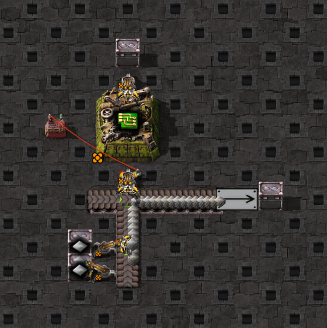
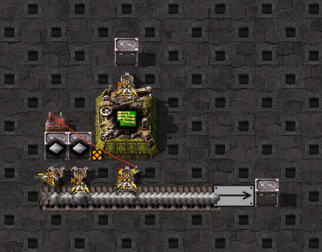

# Side-loading into a straight pickup tile: unmodeled supply entry

This paired experiment identifies a simulator gap. A straight belt's exposed line length does not establish
how much of that line a moving item stream traverses before an inserter can collect it. Items fed from the side
can enter near the downstream end, leaving most of the pickup tile empty even while the incoming lane is full.

## Layouts



`side-loaded-scaffold.txt` has an eastbound straight turbo pickup belt, an unmirrored legendary stack inserter
north of it, and an iron-plate feed arriving from the south. An empty west-side belt stub keeps the pickup tile's
shape straight. Two legendary feeder inserters keep the incoming right lane full; its left lane stays empty.
The output continues east into a drain loader and disposal chest, so the belt is free to move. The receiving
legendary assembler has the electronic-circuit recipe, but receives no copper cable and cannot start a craft.



`straight-through-scaffold.txt` rotates the same feed infrastructure west of the pickup and removes the empty
stub it replaces. The pickup tile, input inserter, machine, output drain and feeder capacity are retained.
Both layouts use `config.json`, which describes a moving one-tile straight pickup with iron on physical lane 2.
The screenshot settings are in the [game guide](../../../../README.md#scaffold-screenshots); these are layout
references rather than the probe's exact starting state or evidence of timing.

## Setup and measurement

Measured on 2026-10-18 in Factorio 2.1.21 with legendary stack inserters, hand capacity 16 and four-item turbo
belt stacks. An empty wired constant combinator holds the machine input disabled during 1,200 warm-up ticks.
The probe verifies an empty hand and a straight eastbound pickup tile, disables circuit enable control/filters,
sets hand capacity 16 and clears machine inventories once. It observes ticks 1–30 using the shared capture and
belt snapshot helpers. It does not insert items, modify feeder hands or refill belts through Lua.

Generic staged saturation is deliberately not used: the side-fed pickup tile is never populated along its whole
line. Instead, each sample verifies that the incoming right lane contains 16 items and cannot accept another
stack at its back. This condition holds through both first hands. Machine inputs/output stay empty and crafting
progress stays zero throughout them, excluding destination blocking and upstream feeder starvation as explanations.

| Feed into pickup | Exposed length, each lane | Initial lane-2 stacks | Game grab offsets | Full-tile simulator offsets |
| --- | --- | --- | --- | --- |
| Straight through from west | 1 tile | 4 stacks of 4 | `0,1,2,3` | `0,1,2,3` |
| Side-loaded from south | 1 tile | 1 stack of 4 | `0,2,4,6` | `0,1,2,3` |

Both hands collect 4, 8, 12 and 16 iron plates. The side-fed hand grabs each arriving stack near the pickup tile's
downstream end. The single initial stack is at transport-line position `0.01171875` at probe tick 1; the rest of
that lane is empty. The straight-through control starts at positions `0,0.25,0.5,0.75` and matches the current model.
The incoming lane remains full in both layouts while these differences develop on the pickup tile.

## Modeling gap

The current moving model assumes an evenly spaced train spans the exposed pickup length. That works for the
straight-through control and overestimates availability in the side-fed case. Both turbo phases predict four
consecutive grabs with `pickup_length: 1`. Selecting the supported underground length `0.5` also fails to match
the observed `0,2,4,6` pattern; changing physical geometry is not an accurate representation of this topology.

Sidecar 0.11.0 captures `near_lane: 1` and `pickup_length: 1` without a pickup warning in both cases. It exports
the single populated belt lane as an iron lane, but carries no information about the stream entering at the side
of the pickup tile. Geometry capture is not sufficient to establish a fully supplied moving pickup window.

This case needs supply-entry information separate from physical pickup geometry. The exact representation and
general rule for other incoming lanes, directions, multiple feeds, speeds and backed-up supply are not derived
here. No simulator behavior or Sidecar capture change is included. The game test explicitly asserts the known
side-loading mismatch and the matching control; a passing experiment is **not** a claim of simulator agreement.
The investigation pauses at this gap before advancing to another mechanics case.

## Reproduce

From `clock-generator/`, with the [game setup](../../../../README.md#setup):

```bash
npm run test:game -- tests/game/mechanics/belt-pickup/side-loaded-straight.game.test.ts
npm run screenshots -- --case=side-loaded-straight
npm run screenshots -- --case=side-loaded-straight/control
```

The game test checks both layouts, the populated incoming lane, initial source stacks, hand counts, machine
state, current Sidecar capture/export and simulator predictions. It composes `probe.lua`, then removes temporary
recordings. Reports retain the shared `front-pickup.json` schema with `initial` metadata and `samples`, adding
incoming `feed` lane counts/fullness to every sample. Raw manual captures remain locally under
`work/belt-pickup/side-loaded-single-lane-moving-01/` and `straight-through-single-lane-moving-01/`.
