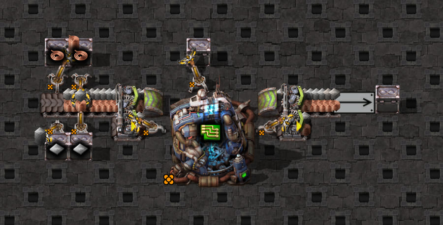

# Two serial turbo splitters feeding one machine

The supplied [scaffold](scaffold.txt) has two eastbound turbo splitters in series, each with a pickup inserter.
The first north output feeds the second north input through an underground belt. The second north output
drains through a turbo loader into a disposal chest. Both south outputs have no continuation belt and back up
between pickups. Four feeder inserters maintain iron/cable stacks of four at the first north input.



Native screenshot of the supplied build, compressed with the existing script to a quality-82, 900×459 JPEG
(about 81 KiB from a 672 KiB PNG). It shows the original layout with right-output priority on both splitters;
the measurements add a shared startup gate. Raw screenshot artifacts are under ignored
`work/mechanics-screenshots/2026-10-18T21-08-52-459Z/`.

## Geometry and controlled setup

| Target | Source | Pickup approach | Original mirroring |
| --- | --- | --- | --- |
| Left/upstream, blueprint #14 | First splitter's south port | From the output side, facing west | False |
| Right/downstream, blueprint #19 | Second splitter's south port | From the input side, facing east | True |

These are distinct pieces and approaches, not two inserters competing on one splitter. Both deliver to the
same legendary electromagnetic plant making electronic circuits. Each inserter can affect the other's
ingredient eligibility through the shared machine; upstream withdrawals also affect downstream supply.
Differences between the two targets alone cannot establish a mirroring rule.

Every test starts its **own Factorio session and copied save**. Both target inserters are gated during 1,200
natural warm-up ticks, with feeders running and the drain retained except in the blocked-drain control, then
released in the same game tick. An empty constant
combinator and wires establish the startup gate. Both hands and the machine must be empty at release.
The probe never seeds belts, edits held items, clears machine inventories, or toggles priority during capture.
It records 120 ticks of both hands, all eight lines of each splitter, the other belts/underground transport
lines, stack IDs and positions, and the operating machine. Hand capacity is 16; Factorio version is 2.1.21.

The [config](config.json) is an ordinary-belt comparison input, not supported splitter geometry or routing.
The [probe](probe.lua) uses shared capture and snapshot helpers rather than a separate recording framework.

## Run the independent priority tests

From `clock-generator/`, with the [game harness configured](../../../../README.md):

```bash
# Separate tests, separate fresh sessions; output priority is fixed before warm-up.
npm run test:game -- tests/game/mechanics/belt-pickup/splitter-two-inserters.game.test.ts -t 'right priority, original$'
npm run test:game -- tests/game/mechanics/belt-pickup/splitter-two-inserters.game.test.ts -t 'no priority, original$'

# Independent single-splitter controls; the other splitter retains right priority.
npm run test:game -- tests/game/mechanics/belt-pickup/splitter-two-inserters.game.test.ts -t 'upstream priority unset only$'
npm run test:game -- tests/game/mechanics/belt-pickup/splitter-two-inserters.game.test.ts -t 'downstream priority unset only$'

# Close only the final outlet, retaining both unset priorities and all startup settings.
npm run test:game -- tests/game/mechanics/belt-pickup/splitter-two-inserters.game.test.ts -t 'no priority, blocked drain$'

# Includes all ingredient/mirroring controls, also in fresh sessions.
npm run test:game -- tests/game/mechanics/belt-pickup/splitter-two-inserters.game.test.ts

# Isolate the downstream/input-side mirror flip, retaining swapped ingredients and right priority.
npm run test:game -- tests/game/mechanics/belt-pickup/splitter-two-inserters.game.test.ts -t 'swapped-right-unmirrored$'

# Retain exact blueprints, generated Lua, configs, native reports and recordings in a new directory.
SPLITTER_TWO_CAPTURE_DIR=../work/belt-pickup/turbo-two-new-run npm run test:game -- tests/game/mechanics/belt-pickup/splitter-two-inserters.game.test.ts
npm run screenshots -- --case=splitter-two-inserters
```

The priority comparison keeps original ingredients, original mirroring, gate timing and all geometry fixed.
The no-priority blueprint omits only the `output_priority` fields on splitters #12 and #20. The upstream-only
control omits only #12's field; the downstream-only control omits only #20's. Native metadata asserts each
splitter's expected priority independently, including the retained `right` setting. Both input priorities remain
unset and neither splitter has a filter. Each retained variant has its own subdirectory; nonempty run directories
are refused. The test does not reuse a running world to produce its comparison.

## Findings

At release, each south output has two stacks per line at 0 and 1/4 tile. Lines 7 and 8 are the south output
lines; the populated north input lines 1 and 2 have lengths 179/256 tile, and output lines have length 1/2 tile.
The original ingredients put iron on 7 and cable on 8; swapping exchanges only the four feeder chest filters.

| Independent case | Left first hand | Right first hand | Left grab ticks | Right grab ticks |
| --- | --- | --- | --- | --- |
| Both right, original | Iron, line 7 | Cable, line 8 | 2,3,4,5 | 2,3,4,5 |
| Both right, ingredients swapped | Cable, line 7 | Iron, line 8 | 2,3,4,5 | 2,3,4,5 |
| Both right, swapped + left mirrored | Iron, line 8 | Iron, line 8 | 2,3,4,5 | 2,3,4,5 |
| Both right, swapped + right unmirrored | Cable, line 7 | Cable, line 7 | 2,3,4,5 | 2,3,4,5 |
| Both unset, original | Iron, line 7 | Cable, line 8 | 2,3,4,7 | 2,3,4,7 |
| Upstream unset only, original | Iron, line 7 | Cable, line 8 | 2,3,4,7 | 2,3,4,5 |
| Downstream unset only, original | Iron, line 7 | Cable, line 8 | 2,3,4,5 | 2,3,4,7 |
| Both unset, final drain removed | Iron, line 7 | Cable, line 8 | 2,3,4,5 | 2,3,4,5 |

The left target's ingredient swap and mirror controls reproduce its earlier physical line preference: line 7
unmirrored, line 8 mirrored. Flipping only the right target from mirrored to unmirrored, retaining swapped
ingredients, changes its first pickup from line 8 iron to line 7 cable. This independently establishes the
same local preference on the input-side approach; it is not inferred by comparing the two different approaches.
In every first hand the other output line remains
untouched. Consumed IDs were last observed on `7,1,7,1` or `8,2,8,2` as appropriate. The trace reconciles
both splitters and connecting pieces so routing is not mistaken for pickup. It does not prove direct access
to input lines: routing and consumption may occur between observations.

**Priority changes replenishment timing.** At tick 5, right priority gives both hands 16 items; without
priority both still hold 12, reaching 16 at tick 7. The next right-priority hands both grab at 13,14,15,17.
Without priority, the left hand grabs at 15,16,17,21 and the right at 15,16,19,23. Turbo speed is unchanged;
the routing decision changes when reachable replacement stacks arrive. These observations do not define
a universal splitter delay or establish a complete routing algorithm.

## Isolating the priority-dependent delay

The two new controls retain the original ingredients and mirroring and release both gates at the same tick.
Each is a separate test with a fresh session, save copy and warm-up. Captured blueprint comparisons show one
changed field per control: omit upstream #12's `output_priority`, or omit downstream #20's. No other setting
changes and priorities stay fixed throughout each run.

The delayed first hand follows **the splitter whose priority is unset**. Unsetting upstream priority delays
only the upstream first hand to tick 7; the downstream first hand still finishes at 5. Unsetting downstream
priority reverses that result. Thus the downstream first-hand delay in the both-unset test does not require
the upstream priority to be unset. This conclusion is about the prefilled startup condition, not every later hand.

The native ID trace shows the mechanism in each isolated case. At tick 4 the next matching stack is on the
affected splitter's input line at position **19/256 tile**. At tick 5 that same stack is on the **north output
at 1/4 tile**, heading along the drain route rather than replenishing the empty south pickup line. The hand
holds 12 items during ticks 4–6, then a later stack completes it at tick 7. The observed machine inventories
are still empty throughout this first collection, excluding a machine insertion-limit block as its cause.
The unchanged preferred ingredient line also excludes a lane-selection switch in these controls.

This is a local routing/diversion result, not a fixed two-tick surcharge to add to every pickup. Later hands
influence each other through transport stock and the shared machine. For example, upstream-only unset priority
gives downstream third/fourth hands at 30,31,32,33 and 60,61,62,63. Downstream-only unset priority gives its
downstream third hand at 31,32,35,60; its upstream third hand instead collects cable at 25,26,30,31. All complete
hand sequences are fixed as regression expectations. The native counter is 27 after 120 ticks in both isolated
cases, as in the other original-ingredient priority controls; no steady-throughput conclusion follows from that.

Both independent filtered commands passed using separate processes and output directories. All seven controls
also passed together, with validated reports, exact blueprints and generated probes retained under ignored
`work/belt-pickup/turbo-two-splitter-priority-isolation-final-01/`. The regression additionally tracks the diverted
native ID into the north output while the pickup line is empty, not just the eventual full-hand tick.

**Later hands depend on both stock and machine eligibility.** Recovered stock can give another `0,1,2,3`
hand, so `0,1,2,4` is not a fixed rule for every later collection. With ingredients swapped and right priority,
the downstream fourth cable hand grabs at 58,59,60,88. Cable is initially absent at its output; it returns while
that hand still holds 12. At ticks 70–87 two cable stacks are present, but the machine's earlier inventory
samples keep cable blocked under the engine's existing insertion-limit rule (calculated limit 39). Once the
previous sample falls to 38, the hand finishes at 88. This checks the existing eligibility rule against
observed inventory; it is not a full splitter simulation or a fresh calibration of that limit.

Mirroring only the upstream target with swapped ingredients makes both first hands iron. The downstream fourth
cable hand then grabs at 70,71,72,100. Shared ingredient buffering changes the subsequent schedule. The native
`products_finished` counter reaches 27 after 120 ticks for the original, swapped and no-priority cases, and 24
for the mirrored-left case. These startup observations do **not** establish steady throughput or a permanent
loss without priority. A clock expecting a full hand at tick 5 would nevertheless encounter a partial hand in
the no-priority case.

## Both priorities unset, final drain removed

This independent control derives from the both-unset moving case by removing **only drain loader #22**.
The disposal chest remains. Ingredients, mirroring, both unset output priorities, 1,200-tick natural warm-up,
shared gate release and 120-tick observation window are unchanged. The native probe asserts that the drain is
absent. At release the two stacks on each south output are still at 0 and 1/4 tile; all observed splitter and
connecting belt stock stays stationary through tick 1. The screenshot above shows the supplied layout with
the loader present; this control removes that one loader rather than introducing another scaffold.

| Hand | Left item and grab ticks | Right item and grab ticks |
| --- | --- | --- |
| 1 | Iron: 2,3,4,5 | Cable: 2,3,4,5 |
| 2 | Cable: 13,14,15,18 | Cable: 13,14,15,16 |
| 3 | Iron: 28,29,30,31 | Cable: 28,29,30,31 |
| 4 | Cable: 58,59,60,63 | Cable: 58,59,60,61 |

Closing the final drain removes the **initial** delay: both first hands finish at 5 rather than 7 in the
both-unset moving control. Their corresponding north-output ingredient stock stays unchanged throughout
that first hand, and the machine inventories are empty, separating initial backpressure from machine limits.

It does not ensure one stack per tick forever. During the upstream second hand, a cable stack on input line 2
at position 0 on tick 15 appears on north output line 6 at **45/256 tile** on tick 16. The south cable pickup
line is empty and the hand remains at 12 through tick 17, finishing at 18. Other withdrawals can open space
in a network even when its final drain is blocked. The tracked diversion establishes that a through route
has reopened; this capture does not specify the complete routing algorithm or attribute every gap to one consumer.

The regression checks the engine's existing machine-input eligibility rule against the previous native
inventories on ticks 13–18: cable remains eligible throughout. An isolated collection comparison with ordinary
`backed_up_belts: true`, the observed cable item and those same inventories fills at 13,14,15,16 instead.
That comparison deliberately excludes arm movement and splitter routing. It demonstrates why the engine's
infinite backed-up supply assumption cannot represent this coupled splitter network simply because the last
loader was removed. No constant delay or new splitter support is added. Sidecar continues warning for both
unsupported sources. The native product counter is 27 at tick 120; this is not a steady-throughput measurement.

All eight independent controls passed with complete hand sequences, startup stock, within-run ID traces and
both Sidecar warnings asserted. The seven earlier controls passed in
`work/belt-pickup/turbo-two-splitter-blocked-drain-final-02/`; the new blocked-drain control passed after the
comparison included native product inventory in
`work/belt-pickup/turbo-two-splitter-blocked-drain-final-03/`. These ignored directories retain exact blueprints,
configs, generated probes and native reports. Comparing the final captures confirms that removing loader #22
is the only blueprint difference from the both-unset moving control, and their configs are identical.

## Downstream-only mirroring follow-up

This test differs from the right-priority swapped control only in target #19's `mirror` field, set from `true`
to `false`. Target #14 remains unmirrored; both output priorities remain right, and both gates release together
after the same warm-up. Captured blueprints are checked for that single-field difference. Both first hands
now collect cable, so the machine receives no iron until a later hand. First-hand collection timing is unchanged.

| Hand | Left item and grab ticks | Right item and grab ticks |
| --- | --- | --- |
| 1 | Cable: 2,3,4,5 | Cable: 2,3,4,5 |
| 2 | Cable: 13,14,15,17 | Cable: 13,14,15,17 |
| 3 | Iron: 25,26,27,29 | Iron: 25,26,27,29 |
| 4 | Cable: 82,83,84,85 | Cable: 82,83,84,85 |

The first right-hand consumed IDs have prior-observation lines `7,1,7,1`, replacing `8,2,8,2`; its line 8 iron
stock stays unchanged during the first cable hand. The machine's native `products_finished` counter reaches 21
at tick 120. As with the upstream-only mirror result, the different startup ingredient order and buffering
change the observed schedule. This is not a steady-throughput claim or a new routing model.

All five controls passed together in the retained capture
`work/belt-pickup/turbo-two-splitter-input-mirroring-final-01/`, with one subdirectory per test. Original
priority/no-priority evidence also remains at the earlier run listed below. No priority is changed at runtime.

## Simulator impact and remaining scope

No production engine or Sidecar change is made. The selection controls agree with the earlier local preference;
the long partial-hand interval includes an already modeled sink block. Serial routing, finite shared supply
and output priority remain unmodeled for splitter pickups. Sidecar therefore retains a separate `splitter`
warning for each target and omits pickup geometry/lane preference. Successful ordinary-belt generation from
the comparison config would not verify this build.

Validated raw evidence belongs under ignored `work/belt-pickup/turbo-two-splitter-final-01/`, one folder per
independent case. The regression asserts every observed hand's item and exact grab ticks, first-hand stock/ID
traces, final native product counters, the existing machine-block classification, and both Sidecar warnings.
Opposite input arrangements and filtered routing remain unmeasured. Removing the final drain now covers
initially stationary serial supply, but does not establish permanently saturated local stock. Priority
isolation establishes a local first-hand cause, not a complete simulation of splitter scheduling. Continue with
one controlled change at a time.

## Four-speed coverage

The same eight independent controls now run at turbo, express, fast and normal speed. The transformation
changes every belt, underground, loader and splitter prototype consistently, retaining ingredients, priorities,
mirroring and gate timing. Native assertions verify paired undergrounds and the actual prototypes before release.
Each slower control has 120 observed operating ticks after the same 1200-tick natural warm-up.
[Measured baselines](speed-expectations.json) retain both inserters' complete hand sequences, initial eight-line
stock without process-specific IDs, and final product counts. Turbo retains its existing detailed assertions.

| First hand, native ticks | Turbo | Express | Fast | Normal |
| --- | --- | --- | --- | --- |
| Both priorities set, both inserters | 2,3,4,5 | 2,3,5,8 | 2,3,5,9 | 2,3,4,12 |
| Only upstream priority unset: upstream | 2,3,4,7 | 2,3,5,10 | 2,3,5,13 | 2,3,4,20 |
| Only upstream priority unset: downstream | 2,3,4,5 | 2,3,5,8 | 2,3,5,9 | 2,3,4,12 |
| Only downstream priority unset: upstream | 2,3,4,5 | 2,3,5,8 | 2,3,5,9 | 2,3,4,12 |
| Only downstream priority unset: downstream | 2,3,4,7 | 2,3,5,10 | 2,3,5,13 | 2,3,4,20 |
| Both priorities unset, both inserters | 2,3,4,7 | 2,3,5,10 | 2,3,5,13 | 2,3,4,20 |
| Both unset and final drain removed, both inserters | 2,3,4,5 | 2,3,4,5 | 2,3,4,7 | 2,3,4,11 |

Ingredient swaps and the two independent mirroring flips retain the first-hand timing shown for priorities set;
they change which ingredient is selected. Later hands and product counts vary with routing and shared machine
eligibility, so this table is not a constant-delay rule. Removing the final drain does not guarantee four
consecutive pickups at every speed. Splitter capture remains explicitly unsupported, with no inferred pickup
length or lane. No splitter simulation has been introduced.

Raw runs: ignored `work/belt-speed-coverage/splitter-natural-01/serial/`. Re-evaluate retained evidence without
launching Factorio by setting `SPLITTER_REPLAY_DIR` to that serial directory and running this test file.
