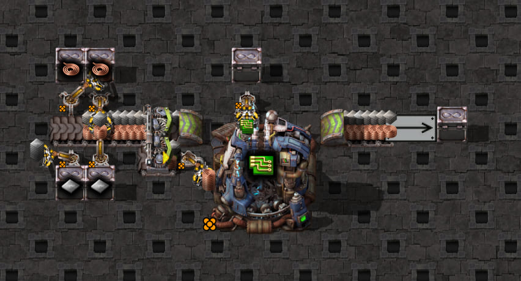

# Direct turbo splitter pickup — priority-port controls

The supplied [scaffold](scaffold.txt) has one north input to an eastbound turbo splitter, right-output priority,
and no splitter filter or input priority. Four legendary stack inserters maintain four-item iron/cable stacks.
A legendary, unmirrored stack inserter stands immediately east of the south output and feeds electronic circuits
in a legendary electromagnetic plant. The north output drains through an underground belt and turbo loader.
The south output has no continuation belt: its stock backs up between pickups, even while the north output moves.



Native screenshot of the supplied build, captured with the shared screenshot script. The JPEG is 852×459,
quality 82, about 76 KiB, compressed from a roughly 630 KiB PNG. It illustrates the original layout; the timing
test adds a circuit gate for controlled startup. Raw PNG and screenshot recording remain under ignored
`work/mechanics-screenshots/2026-10-18T20-54-22-187Z/`.

## Reproduce these controls

Run from `clock-generator/`, using the Factorio configuration described in the [game guide](../../../../README.md):

```bash
npm run test:game -- tests/game/mechanics/belt-pickup/splitter.game.test.ts

# Select only the ingredient-swapped control.
npm run test:game -- tests/game/mechanics/belt-pickup/splitter.game.test.ts -t 'ingredients swapped\)$'

# Select only the mirrored control with swapped ingredients retained.
npm run test:game -- tests/game/mechanics/belt-pickup/splitter.game.test.ts -t 'ingredients swapped, mirrored'

# Retain the exact transformed blueprint, generated Lua, config, recording and native report.
# Choose a new empty directory for each run.
SPLITTER_CAPTURE_DIR=../work/belt-pickup/turbo-splitter-new-run npm run test:game -- tests/game/mechanics/belt-pickup/splitter.game.test.ts

npm run screenshots -- --case=splitter
```

The test holds only the target inserter with a circuit gate during 1,200 natural warm-up ticks, leaving the
feeder inserters running; the northern drain is retained except in the explicit blocked-drain control. A temporary empty constant combinator establishes the circuit
connection; belt geometry, priority and gate timing stay fixed across the controls. Mirroring changes only in
the explicitly mirrored variant. The probe asserts an empty
hand and empty, idle machine, then disables that inserter's circuit condition and records 60 ticks. It neither
seeds transport lines nor edits held items nor clears destination inventories. The machine operates normally.

The [probe](probe.lua) composes shared observation/capture helpers. It enumerates all splitter transport lines,
and observes upstream and downstream lines, stack IDs/counts/positions, held items, and machine inventories.
[config.json](config.json) is an **ordinary-belt comparison**, not a claim that the simulator supports splitters.
All six test variants share that setup and probe; the blocked-drain control removes only loader #20. The ingredient-swapped control changes only the four feeder
chests' iron/cable filter names and the comparison config's ingredient lanes. Retained captures are separated
into `original/`, `swapped/`, `swapped-mirrored/` and `blocked-drain/` under `SPLITTER_CAPTURE_DIR`.

## Measured baseline

Factorio **2.1.21**, hand capacity 16, belt stack size four, turbo speed, unmirrored input. At release:

| Transport lines | Observed length | Stock/role in this layout |
| --- | --- | --- |
| 1–2 | 179/256 tile each | Populated input: iron on 1, cable on 2 |
| 3–4 | 179/256 tile each | Empty input |
| 5–6 | 1/2 tile each | North output, draining into the underground |
| 7–8 | 1/2 tile each | South output: two blocked four-item stacks per line, at positions 0 and 1/4 |

The first sample has an empty hand; the following hands fill as below. Ticks are relative to gate release,
not absolute simulation phase or a statement about every inserter arrival orientation.

| Hand | Item | Grab ticks | Offsets from first grab |
| --- | --- | --- | --- |
| 1 | Iron plate | 2, 3, 4, 5 | 0, 1, 2, 3 |
| 2 | Copper cable | 13, 14, 15, 17 | 0, 1, 2, 4 |
| 3 | Copper cable | 25, 26, 27, 29 | 0, 1, 2, 4 |
| 4 | Copper cable | 37, 38, 39, 41 | 0, 1, 2, 4 |
| 5 | Iron plate | 49, 50, 51, 53 | 0, 1, 2, 4 |

Each grab adds four items and the hand keeps its item throughout collection. Line 8's cable stacks remain
unchanged during the entire first iron hand. Of line 7's initial iron stacks, the upstream stack at 1/4 tile
is removed first, leaving the stack at the blocked end; the latter disappears on the third grab.

Tracking IDs across samples places the four consumed iron stacks on lines **7, 1, 7, 1 in the preceding
observation**. This does not prove the arm directly reaches input line 1: the splitter may route a stack into
the output and the inserter may consume it between two observations. The initial output stock alone contains
only eight iron plates, so routing during collection supplies the rest of the hand.

Validated raw evidence is retained under ignored `work/belt-pickup/turbo-splitter-baseline-06/` (with the same
measurements also reproduced in runs 04–05). Earlier attempts failed setup or host assertions and are not the
validated regression run. The regression fixes the source/line
observations and all five hand sequences above rather than just asserting eventual pickup.

## Ingredient-swapped control

Swap the four feeder chests' ingredient names without changing the recipe, stack sizes, splitter priorities,
inserter mirroring, wiring, 1,200-tick warm-up or gate release. The recording confirms the same unmirrored
west-facing pickup, right-output priority, no input priority and no splitter or inserter filter.
All eight line lengths are unchanged. At release, line 7 contains two four-item **cable** stacks, and line 8
contains two four-item **iron** stacks, again at positions 0 and 1/4 tile.

| Hand | Item | Grab ticks | Offsets from first grab |
| --- | --- | --- | --- |
| 1 | Copper cable | 2, 3, 4, 5 | 0, 1, 2, 3 |
| 2 | Copper cable | 13, 14, 15, 17 | 0, 1, 2, 4 |
| 3 | Copper cable | 25, 26, 27, 29 | 0, 1, 2, 4 |
| 4 | Iron plate | 37, 38, 39, 41 | 0, 1, 2, 4 |

The first hand now takes cable from the **same physical line 7**, leaving line 8's iron stock unchanged.
Its consumed stack IDs have the same preceding-observation line sequence `7,1,7,1`. The trace accounts for
north-output stacks transferred downstream, so draining stock is not mistaken for pickup. The initial upstream
stack at 1/4 tile is taken before the blocked-end stack, as in the original arrangement.

The first choice therefore follows the physical line in these two arrangements, rather than a fixed iron-first,
cable-first or recipe ordering. Once collecting, the hand continues with its held item. This establishes a
preference for this unmirrored pickup with both ingredients needed; it does not rank every splitter line or
prove the same preference for other orientations, filters or priorities. The mirroring follow-up below tests
the other hand orientation in this exact layout.

The machine operates normally after release, so swapping supply also changes later ingredient buffering and
the number of hands seen within 60 ticks. Both controls retain the same per-hand pause once initial stock has
been withdrawn. Validated raw captures and exact derived blueprints are retained under ignored
`work/belt-pickup/turbo-splitter-ingredient-swap-02/original/` and `.../swapped/`. The native regression checks
both variants' initial stock, first-hand IDs, all complete hand timings and the existing Sidecar warning.

## Mirrored control with swapped ingredients

Retain the swapped ingredients, then change only target inserter #14's blueprint `mirror` field to `true`.
The captured blueprint differs from the unmirrored swapped variant in exactly that field. The right-output
priority, absent input priority/filter, circuit condition, wiring, warm-up, gate release, pickup position,
inserter direction and splitter geometry are unchanged. Native capture confirms `mirrored=true`.

At release, the physical stock is unchanged: cable occupies line 7 and iron occupies line 8. The first hand
now takes **iron from line 8**, leaving line 7's cable stock unchanged for the whole hand. Its consumed IDs
were last observed on lines `8,2,8,2`, compared with `7,1,7,1` before mirroring. These input-line observations
remain evidence of routing between samples, not proof that the inserter reaches the input lines directly.
The first initial stack taken is again the one at 1/4 tile; the blocked-end stack is taken on the third grab.

| Hand | Item | Grab ticks | Offsets from first grab |
| --- | --- | --- | --- |
| 1 | Iron plate | 2, 3, 4, 5 | 0, 1, 2, 3 |
| 2 | Copper cable | 13, 14, 15, 17 | 0, 1, 2, 4 |
| 3 | Copper cable | 25, 26, 27, 29 | 0, 1, 2, 4 |
| 4 | Copper cable | 37, 38, 39, 41 | 0, 1, 2, 4 |
| 5 | Iron plate | 49, 50, 51, 53 | 0, 1, 2, 4 |

Together these controls establish a mirroring-dependent first choice for the south port of this eastbound,
right-priority splitter: **line 7 unmirrored, line 8 mirrored**, when both ingredients are needed. Mirroring
does not change the observed first-hand or later-hand grab timing. It changes which item the machine receives
first, so the subsequent recipe buffering and hand sequence follow that choice.

Validated captures are under ignored `work/belt-pickup/turbo-splitter-mirrored-swap-02/`, with all three variants
in separate subdirectories. The regression asserts the untouched other line, consumed-ID trace, initial stock,
all complete hands and Sidecar's unsupported warning in each case. It does not establish other ports, cardinal
orientations, priorities, filters or supply conditions.

## Single-inserter blocked-drain control

Remove only north drain loader #20 from the original scaffold, retaining right priority, original ingredients,
unmirrored target, shared startup procedure and natural 1,200-tick warm-up. The native probe asserts that the
loader is absent. Initial splitter stock is stationary through tick 1. North output lines 5/6 and the observed
downstream underground stock remain identical to their initial snapshots throughout all 60 ticks.

| Hand | Item | Grab ticks |
| --- | --- | --- |
| 1 | Iron | 2,3,4,5 |
| 2 | Cable | 13,14,15,16 |
| 3 | Cable | 24,25,26,27 |
| 4 | Cable | 35,36,37,38 |
| 5 | Iron | 46,47,48,49 |
| 6 | Cable | 57,58,59,60 |

Every hand collects one four-item stack per tick. The second hand now agrees with the engine's isolated
backed-up collection assumption. This does not authorize automatic splitter support: the serial two-inserter
control shows that downstream withdrawals reopen a through route even without a final drain. The useful rule
is local stock availability, rather than inferring permanent saturation from a closed final outlet. Right
priority is retained here; priority-free and filtered splitter routing require their own controls.

All four independent controls passed with exact per-hand expectations, first-hand ID traces, native drain
metadata and Sidecar warnings. Raw artifacts are under ignored
`work/belt-pickup/single-splitter-blocked-final/`. Reproduce only this control with
`npm run test:game -- tests/game/mechanics/belt-pickup/splitter.game.test.ts -t 'drain removed'`.

## Single-splitter output-priority isolation

Two additional independent controls unset only splitter #12's output priority: one retains the drain, and the
other derives from the blocked-drain control. Ingredients, mirroring, gate timing and warm-up stay fixed.
Each uses a fresh copied save. No priority changes during capture.

With the drain retained, first-hand iron grabs are **2,3,4,7**. The next matching stack is on input line 1 at
19/256 tile on tick 4, then on north output line 5 at 1/4 tile on tick 5 while the south pickup is empty.
Later hands are cable at 15,16,17,21 and 29,30,33,37; iron at 45,46,47,51; and a partial cable hand at 59,60.
This reproduces the local diversion seen in the serial fixture without requiring a second consumer.

With the drain removed, unsetting priority changes none of the six observed hand items or grab ticks from the
right-priority blocked-drain control above. Both north output lanes and the observed underground remain
stationary throughout. Thus output priority matters when replacement stock can leave through another outlet;
it is not an unconditional extra pickup delay. This is still a statement about measured local availability,
not a complete splitter arbitration model. Sidecar continues warning rather than silently treating a splitter
as an ordinary belt.

Reproduce each independently with `-t 'priority unset\)$'` or `-t 'priority unset, drain removed'` on the game
command above. All six controls pass; captures are under ignored
`work/belt-pickup/single-splitter-priority-final/`.

## Simulator impact and next control

The first `[4,8,12,16]` hand matches both the current ordinary one-tile moving supply and backed-up supply.
The second hand does not: the game has `[4,8,12,12,16]`, while either ordinary saturated one-tile supply predicts
`[4,8,12,16]` for an isolated cable hand starting at tick 13. The comparison filters the simulator to cable
to isolate supply timing; it does not claim to reproduce the whole operating machine or infer recipe selection.
First-hand agreement therefore cannot identify splitter geometry or prove a generic saturated supply:
replenishment depends on routing into the locally blocked port even as the north output drains.

This is a measured limitation of applying the ordinary-belt approximation to an already unsupported pickup.
It does not yet establish a general splitter timing/routing rule, so the baseline makes **no production simulator
or Sidecar change**. Sidecar still emits the existing
`splitter` warning and omits pickup geometry/preferred lane; normalizing turbo speed does not capture routing.

The ingredient swap confirms a physical line preference, and mirroring switches that preference from line 7
to line 8 without changing the timing limitation. This gives a local selection rule but no general splitter
routing model, so the simulator and Sidecar remain unchanged. The [additional routing controls](routing-controls.md) now cover the opposite output port, both mirroring
states there, the other input arrangement, opposite priority and both ingredient filters. Both priority settings
for the single-consumer blocked-drain control above are complete. No general splitter support is claimed. Continue with turbo
speed and one controlled change at a time.

## Continuous right-priority replay

The first support increment adds an experimental finite-stock replay in
[`splitter-replay.ts`](../../splitter-replay.ts), separate from the production simulator. A fresh baseline
capture on Factorio 2.1.21 matched all eight splitter lines through **all 60 consecutive transitions**,
including each stack's identity, position, item and count. The replay starts from the initial observation
once and never replaces its internal stock with later observations.

For the measured north-input, right-priority layout, the candidate moves existing output stock first, routes
the input head to the preferred south output when it fits (otherwise north), advances the remaining input
stock, and then applies consumer withdrawals. Turbo movement is 32/256 tile per tick; stacks need 64/256
spacing. The observed input line is 179/256 tile long. In this capture, routed stacks enter the output at
64/256 tile. That transfer position and the admission boundary still need independent phase calibration;
they are not yet general routing rules.

Feeder arrivals come from the previous upstream observation. Withdrawals are the externally measured item
and amount on each grab tick. These boundary events isolate splitter routing; this comparison does **not**
predict feeder operation, inserter timing, or downstream backpressure. It cannot by itself enable clock
generation. Four compact native transition cuts in `right-priority-transitions.json` run offline in CI;
the native baseline additionally checks the entire continuous replay.

Reproduce from `clock-generator/`:

```bash
npm test -- tests/game/mechanics/belt-pickup/splitter-replay.test.ts
SPLITTER_CAPTURE_DIR=../work/splitter-support/new-baseline npm run test:game -- tests/game/mechanics/belt-pickup/splitter.game.test.ts -t 'output$'
```

Fresh evidence is retained locally in ignored `work/splitter-support/replay-01/original/`. Compact cuts remap
native IDs consistently to local integers. Sidecar still captures the splitter as unsupported; production
pickup rules are unchanged.

## Input phase, output admission and overflow calibration

Independent seeded controls use the same blueprint, priority and blocked south pickup port, with all
inserters disabled and transport stock cleared before exact positions are inserted. These are bounded
routing calibrations, not natural throughput runs. Actual initial positions are asserted: `insert_at`
materializes one pending 32-unit turbo step in this setup, so insertion coordinates compensate for it.
No held items are edited. Each control uses a fresh native session.

The calibrated right-priority candidate now distinguishes ordinary transfer and overflow:

- A north input head at position `p < 32` can transfer to the preferred south output. Its free landing
  position is `p + 45`. Heads at 0, 19 and 31 land at 45, 64 and 76 respectively; a head at 32 first moves to 0.
- Existing output stock moves first. A landing shifts upstream to preserve 64-unit stack spacing and must
  remain below 128. Output position 127 is accepted; a proposed 128 waits when there is no overflow candidate.
- A blocked preferred output does not imply that an isolated input head diverts. Overflow in these controls
  requires a follower on that same input line at position `q < 96`; the head's alternate landing uses `q - 19`.
  A follower at 95 diverts the head to 76, whereas a follower at 96 first advances to 64 and permits diversion
  on the next tick. A lone final stack stays waiting through the bounded blocked-output controls.

The follower controls support a local queue rule: removing a follower changes routing with the preferred
output unchanged. No additional remembered-choice state was needed to fit these captures. Insertion-order, other-output-lane saturation and upstream-entry
controls reproduce the isolated-head wait. An ordinary upstream belt therefore reproduces the behavior too;
it is not explained solely by inserting directly into the splitter. The tests also record native transport
line connectivity using the [runtime API](https://lua-api.factorio.com/latest/classes/LuaTransportLine.html).
Those links identify possible paths, not the selected destination of an individual stack.

The production engine remains unchanged during calibration. The experimental replay must match every internal
line, item, count, ID and position continuously in each control, as well as the original naturally fed 60-tick
capture. All 27 independent controls and that baseline passed with the revised replay. Its external feeder observations and measured withdrawals remain explicit boundary conditions.
These results do not calibrate other input/output priorities, filters, speeds, stack sizes, input ports or
serial-network arbitration.

```bash
# From clock-generator/: each named test starts its own Factorio session.
npm run test:game -- tests/game/mechanics/belt-pickup/splitter-entry-window.game.test.ts -t 'distance 95$'
npm run test:game -- tests/game/mechanics/belt-pickup/splitter-entry-window.game.test.ts -t 'distance 96$'
# Full scoped regression after evaluating the independent controls:
SPLITTER_ENTRY_CAPTURE_DIR=../work/splitter-support/new-entry-run npm run test:game -- tests/game/mechanics/belt-pickup/splitter-entry-window.game.test.ts
```

The [simulator routing kernel](../../../../../../src/state/turbo-splitter-supply.ts) now backs the replay.
Three additional congestion controls include a stack entering from the ordinary upstream belt: the arrival
shifts to maintain spacing on the input line, accepts position 178, and stays upstream if the proposed position
is 179. All **30** independent controls and the naturally supplied baseline match the kernel. Its accepted
arrival IDs, outgoing stacks, finite withdrawals, snapshots and repeat key prepare it for shared supply
integration. [Integration gates](../../../../../../docs/turbo-splitter-support.md) remain before enabling
splitter configs, Sidecar capture or generated clocks.
