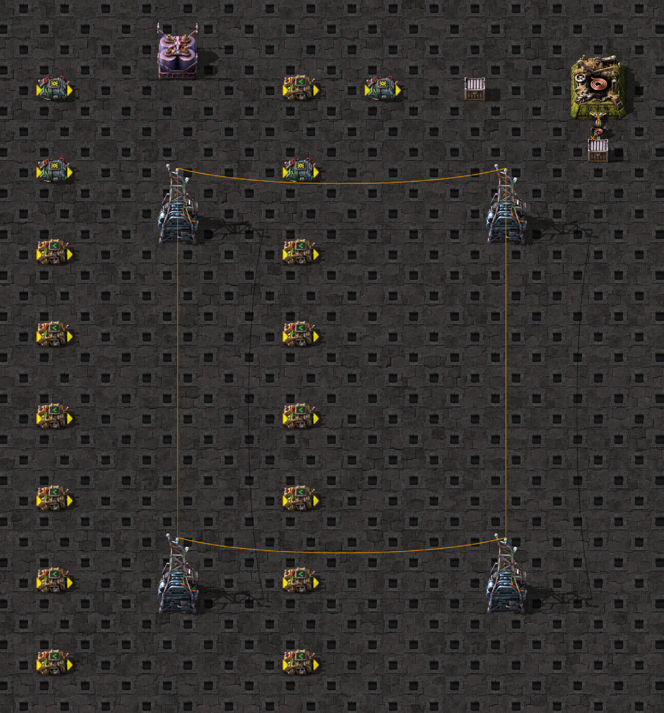

# Actual circuit evaluation and full carry

This exact powered Factorio 2.1.21 scaffold compares fixed A=2 with naturally changing A=1..8, driven by a real
self-loop period8 decider counter C=0..7 and C+1 arithmetic generator. Seven consumers per network have equal
outputs over settled native ticks5–24. Output equality alone cannot establish evaluation work.



The [exact captured blueprint](fixtures/scaffold.txt) is cataloged through `GameFixturePaths.CIRCUIT_EVALUATION`.
The native JPEG shows the warmed scaffold, excluding probe-created output chests, circuit wiring/parameters,
initial stock and interventions. [Generated provenance](../screenshots.generated.json) records its hash and capture
recipe. The [probe](fixtures/probe.lua) reproduces those explicit additions/interventions from [role layout](fixtures/layout.json).

| Consumer | Fixed updates / evaluations | Changing updates / evaluations | Changing indexed conditions |
| --- | --- | --- | --- |
| A*0 → B | 20 / 0 compute | 20 / 20 compute | — |
| A>0 | 20 / 0 | 20 / 20 | 1=true |
| True AND | 20 / 0 | 20 / 60 | 1=true,2=true,3=true |
| False-first AND | 20 / 0 | 20 / 20 | 1=false |
| False-last AND | 20 / 0 | 20 / 60 | 1=true,2=true,3=false |
| True-first OR | 20 / 0 | 20 / 20 | 1=true |
| True-last OR | 20 / 0 | 20 / 60 | 1=false,2=false,3=true |

The arithmetic output is zero on both networks. Decider outputs also match pairwise. Fixed controls still Update:
zero condition/compute calls is **not zero circuit work**. Indexed actual calls and boolean returns establish
short circuit; stored condition count is not an invocation denominator. Stable-input branch omission supports
prior-result reuse, without decoding the game's internal dirty/cache representation.

`native-mapping.json` preserves all18 exact typed role/unit/control mappings (native/Lua type3 inserter,
9 decider,10 arithmetic), PIE-relative vtables, decider vector offsets/32-byte stride and generic condition field.
Entity and control pointers were mapped separately. All4 arithmetic controls use the positively observed
compiler-duplicated thunk **0x34a10c0 with receiver control+24**; an unused parent entry0x34a0e70 is not a zero-update
measurement. Byte/type/getter gates and source observer/code-site hashes remain in provenance.

The clock hand starts empty, actually picks16 cable from source32, then the probe fills every sink slot with4800
iron plates after row1 and connects real C<4 control. The hand carries16 throughout24 rows and both clock edges.
There are3 Alarm/3 inactive→linked attachments at8/16/24 from control finish dispatch; Entity Updates9/17 each
refuse the full sink and directly deactivate without dropping/resetting carry. Attachment24 is after the entity
phase; Update25 is outside the capture. Position, carry, enabled state, list membership and scheduled Update are
separate facts. Direct intercepted deactivation does not upgrade older inferred intervals in other fixtures.

20 generic condition calls belong to native compute. **19 further calls belong to Lua circuit-condition reads**
and remain explicit observer work. The harness regression classifies caller origin before counting entries.
The physical Hand regression supplies source/sink inventories and the measured enabled stream; it derives the real
pickup and persistent carry. It does not derive circuit counts, dispatch membership or exact native phase/status
from that supplied stream. No simulator circuit evaluator is added here.

`validation.json` records final captures04/05 (1538events each), typed gates and raw hashes. All24 complete visible
rows equal reference02 after subtracting only each constant `started` origin from `started`/sample.game_tick.
Raw origins differ by1; every other field matches. Per-role ordered events repeat exactly, but global independent
worker interleaving differs. Never force that interleaving into active-list policy. `events.json` retains all
clock-hand/control events plus representative first-window-tick circuit paths; full normalized sequences remain
ignored. `visible-window.json` retains24 signal/output/carry rows. SHA256SUMS seals all intentional inputs/cuts.

From `clock-generator/`:

```bash
npm test -- src/harness/probe-observations.test.ts src/simulation/components/hand-native-carry.test.ts
npm run test:game -- tests/game/mechanics/circuit-evaluation/circuit-evaluation.game.test.ts
python3 scripts/mechanics/project-native-observations.py /path/to/release-investigations
```

Ordinary CI uses stored call observations, no GDB. The ordinary game test checks equal outputs/real pickup/carry;
it cannot reacquire internal evaluation counts. The exported probe differs only by opt-in debugger pause.
Rejected role-position/nesting/origin pilots remain distinct source evidence. No cap/timeouts increased.

Limits: one powered2.1.21 fixture, plain individual signals/simple AND/OR, no brackets/each/everything, settled
fixed versus continuously changing inputs, one full-destination hand. Other invalidations, network/power states,
whole factories, worker overlap and elapsed cost remain untested. Counts are not prices, Behavior throughput,
Selection, native-pin acceptance or release readiness.
