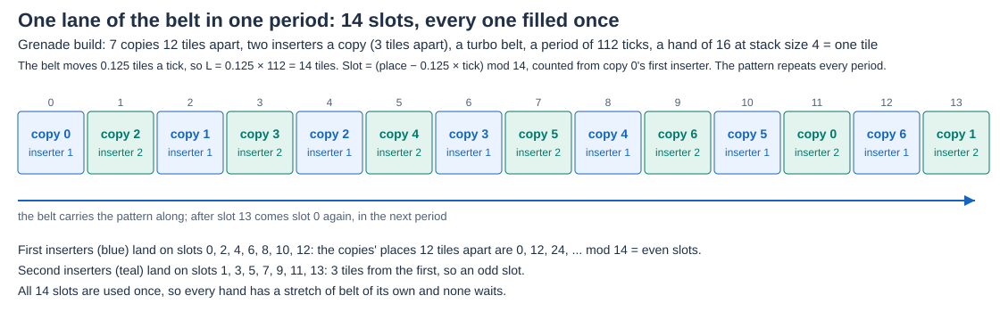
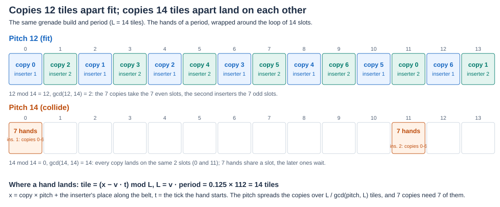
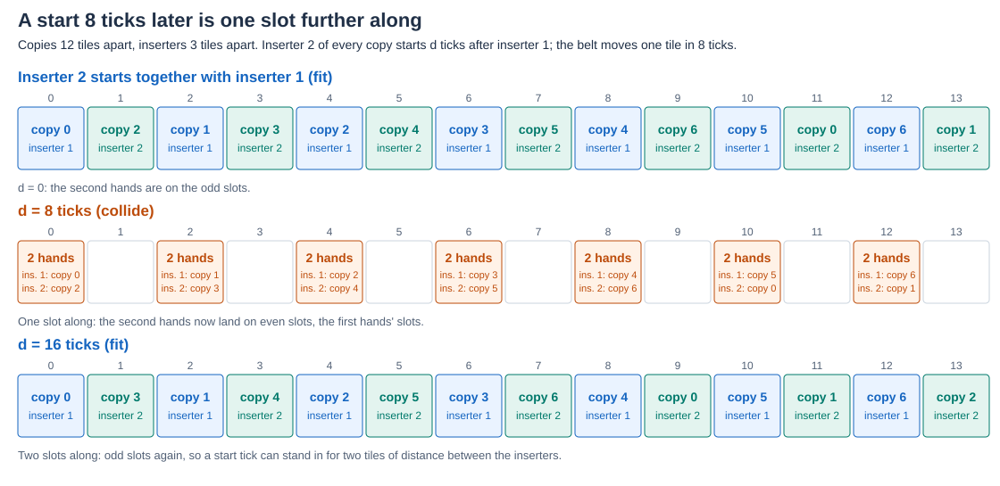

# Drops of several copies onto one belt

Copies of a build can put their products on the same stretch of belt. Each output inserter's hand takes room on the belt
lane, and a hand that finds items at its spot waits until they have moved on. The simulator drops each inserter's hand on a
belt of its own, so it never sees the hands of the other inserters or copies; `src/config/drop-spacing.ts` asks the lane model of the
simulator (`LaneTraffic`) about all of them together, and the result and the editor say what it finds. The model is in
[the simulator page](../../../../docs/simulator.md#drops-of-several-copies-onto-one-belt); this page explains the idea, the
arithmetic and the evidence. The belt calibration the lane model stands on is in
[belt drop](../belt-drop/README.md).

## The model

A turbo belt moves `v` = 0.125 tiles a tick (8 ticks a tile). A lane tile holds four stacks of a quarter tile each, so a hand
takes a quarter tile for each stack it holds: a hand of 16 at stack size 4 is 4 stacks, one tile. On a free lane a hand's stacks land at +0, +1,
+2 and +4 ticks, each a quarter tile behind the one before.

Look at the hands from a frame that moves with the belt. A hand that starts at tick `t` from an inserter standing at place `p`
(tiles along the belt) lies at

    tile = (p - v * t) mod L,    L = v * period

where `L` is the tiles the belt moves in one period of the clock. Every period the belt carries the same pattern past the
inserters, so the question is only whether the hands of one period, wrapped around a circle of `L` tiles, have room:

- **They fit** when no two hands overlap on the circle: each has a stretch of its own. A lane is **exactly full** when the stretches add up to `L`:
  the hands then fit only edge to edge, and nothing is left over.
- **They collide** when two stretches overlap. The hand that starts later is the one that waits.

Copy `k` of a build stands `k * pitch` from the first (`target_output.copy_offset`), and the inserters of a copy stand at their own
places, so the hands of one line (the output inserters of one side of the belt, in one row) are at `p = copy * pitch + place of the inserter`.

## Why the rate, the pitch and the offset matter

- **The rate** sets the period: one output hand at the machine's rate at the target. A longer period is a longer `L`, more tiles in the
  circle. The grenade build makes 240 a second over 7 copies of 4 machines, a hand of 16 every 112 ticks, and so `L` = 14 tiles.
- **The pitch** (the copies' distance) puts copy `c` at `c * pitch mod L`. With `g` the greatest common divisor of the pitch and `L` the copies can only
  take `L / g` different tiles; with more copies than that, two copies drop on the same tile whatever else is done.
  Moving the pitch by a whole `L` moves every hand once round the circle, so whether the hands fit depends on the pitch less whole multiples of `L`
  only: one loop of pitches, from the width of a copy for `L` tiles, holds every answer, and the editor and the result list that loop and say the
  rest are the same plus `L`. Where `L` is not a whole number there is no such loop and a fixed range from the width of a copy is listed.
- **Too many hands.** When the hands dropped on one lane in a period take more of it than the `L` tiles the belt moves in the period (9 copies of one
  inserter on `L` = 4.5), some hands wait whatever the pitch and offset; the editor and the result say so instead of listing spacings.
- **The offset** between a copy's inserters (the second inserter's place, from the first's) moves the second inserter's hands by `offset` tiles
  against the first's, which is what lets them take the tiles the first ones leave.

On the grenade build at 240 a second (period 112, `L` = 14, 7 copies, two inserters in a copy on each line, all starting in the same tick) a scan
of pitches 1 to 28 and offsets 1 to 13 gives:

| Pitch (tiles) | Offset between a copy's two inserters that fits |
| --- | --- |
| even, not a multiple of 14 (2 to 12, 16 to 26) | any odd offset |
| odd, not a multiple of 7 | 7 only |
| a multiple of 7 | none |

Why: an even pitch (`g` = 2) puts the 7 copies on the 7 even tiles; any odd offset puts the second inserters on the 7 odd tiles, so all 14 are
different. An odd pitch not a multiple of 7 (`g` = 1) puts the 7 copies on 7 of the 14 tiles, and an offset of 7 puts the second ones on the
tiles of copies 7 to 13 (since `7 * pitch` is 7 mod 14), which the first row does not use. A pitch that is a multiple of 7 has `g` = 7: the 7 copies share 2 tiles.
The build's pitch of 12 with inserters 3 tiles apart is the first row; its offset can be any odd number.

**A start tick can stand in for a tile.** A hand that starts 8 ticks later is one tile further along the belt (on a turbo belt), so starting the second inserter
`d` ticks after the first has the effect of an offset of `offset - d / 8`. At pitch 12 and offset 3 the second inserter fits starting 0, 16, 32, 48, 64, 80 or 96 ticks after the first, and collides at
the other multiples of 8 (an even offset in effect). The clock that the generator selected before the tie-break of the groups started the second
inserters 56 ticks after the first: 3 - 7 = -4, even, and every second hand landed on a first hand's tile.

The diagrams are written by `scripts/drop-spacing-diagrams.js`, which takes every slot from the model (`src/config/drop-spacing.ts`) and fails if the model's
verdict for a diagram is not the one drawn.

## What a collision costs

The hand that finds items at its spot goes in behind them: it waits, up to a few ticks (8 on the selected clock above; 7 pairs of hands a line landed
on each other). The wait is the same in every period, so it does not change the period; the output inserter is late in the same way each time. Where the
lane has room to spare the wait costs nothing else. Where the lanes are exactly full (the grenade build's 7 x 34.29 = 240 a second on two lanes of 120) nothing is left over
to make a wait up, and a wait that outlasts the period's end would take output with it. The recordings below show waits of up to 8 ticks with the full output kept. The wait is not in the simulator's
rate or stability.

## Evidence

| What | Result | Where |
| --- | --- | --- |
| The test of fit against the simulator's lane model | the same answer on 4,000 of 4,000 random layouts (positions on whole and half tiles, ticks anywhere in the period, 2 to 15 hands; 781 fit, 3,219 collide); the unit test replays 300 | `drop-spacing.test.ts` in `src/config/` (300 layouts, and the table above for every pitch 1 to 28 and offset 1 to 13); the 4,000 layouts were checked once, in PR #373 |
| The model against the game's traces | 1,020 of 1,108 hands exact (no tick off) on 41 recordings of the grenade full build (the hand-made clock, 4 generated clocks, 7 window sets, the 28-offset sweep); 298 of 308 on the 11 whose periods are all alike; the hand-made clock 28 of 28, all at +0, 1, 2, 4 | `tests/game/builds/grenade-clock.game.test.ts` and `grenade-clock-controls.json` record the clocks; the per-tick traces were read once, for PR #373 |
| The sweep of offsets | the model and the game agree on whether any hand waits at 27 of 28 offsets (16 with a collision, 11 without); the exception is 104, where the hands are not full when the inserters start. At 20, 52, 56 and 92 ticks 14 of 28 hands wait for room by the same ticks every period and the build still makes 448 in all 55 periods | PR #373 |
| A prediction made before the recording | the full build with the first north inserter of copy 0 one tile downstream: predicted 13, 15, 17, 19 where 7, 8, 9, 11, the other 27 hands unchanged; the game recorded exactly that, 448 in all 63 periods | PR #373 |
| The pitches and offsets of the table above | a scan of pitches 1 to 28 and offsets 1 to 13 at `L` = 14; repeated by hand for the table | arithmetic on the model |

The code is `src/config/drop-spacing.ts` (PR #373; the choice among equal groupings by the places on the belt, PR #382). The recordings of the grenade
build are `tests/game/builds/grenade-clock.game.test.ts` with `grenade-clock-controls.json`, and the sample's scaffolds are in
`resources/config-samples/real/owner/grenade/`.

## Limits

- **A straight belt.** A line is taken to run straight along its row past the inserters; a belt that bends between inserters is not followed, and the result says so.
- **Side-loading.** An output inserter whose drop is marked as side-loading onto another belt (0.21.0) is left to the merge and not checked here.
- **The belt's direction** comes from the Sidecar (0.14.0) in the drop of each output inserter. Without it the check is made both ways and told only when the two agree; hands that start in the same tick need no direction.
- **The gap between copies** is given by the player or read off the positions when the repeated-unit conversion finds the copies; one export shows the places inside a unit.
- **Whole tiles.** The pitch and offset tables are for whole tiles; the test itself takes any place.
- **Not part of the clock.** Nothing here changes a clock or its ranking; the simulator does not count the wait.
