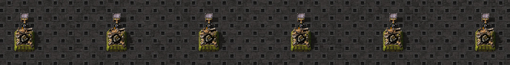

# Source pickup and destination refusal

This Factorio 2.1.21 scenario has six assembler/inserter/container cells. Each source has either one stack of 48 gears
or 48 single-item slots. Destinations are output-overloaded, ingredient-full or accepting. No hand contents are
injected. [GameFixturePaths.SOURCE_SEARCH](../../helpers/fixture-paths.ts) catalogs the [exact scaffold](fixtures/scaffold.scaffold).



The image shows the warmed scaffold; stock and condition interventions are supplied by the ordinary visible-game
scenario. The screenshot catalog retains the exact scaffold hash and game version.

The stored observations distinguish target-full checks, source-slot visits and pickup acceptance. Output-overloaded
destinations cause zero selected source-slot/acceptance checks. Ingredient-full destinations search one versus 48
slots but accept nothing. Accepting destinations take 16 items, checking one stack versus 16 singleton slots; the
remaining source quantity is 32. After that hand is delivered, a later refused pickup checks one versus 32 remaining
slots. All 106 observation-induced target-full checks are excluded from the selected game-action counts.

The nearby simulator test supplies inventories and a pickup opportunity, then derives real pickup/drop, hand quantity
and source depletion. The ordinary game test checks all six held quantities and final source quantities independently.
Zero selected checks do not prove there is no alternative source work. This bounded case establishes no whole-factory
rate, pricing result or universal scheduling order. SHA256SUMS seals the public observations, scaffold and ordinary probe.

```bash
npm test -- src/simulation/components/container-hand-pickup.native.test.ts
```
