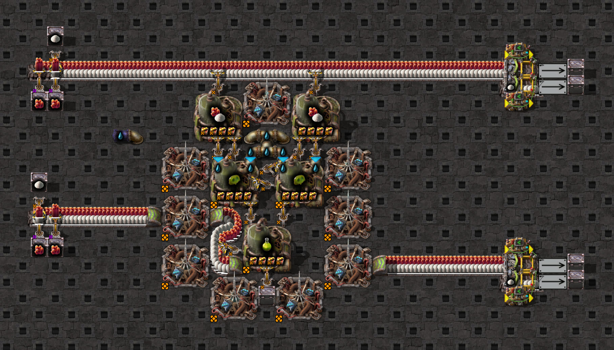

# Staged construction

The staged-start test uses the agricultural-science sample to check that ingredient lanes saturate before fresh
cell inserters are placed in a single tick. It checks ascending and descending construction order, unit-number
order, empty machines, and the configured loop seed. It does not infer startup timing from a screenshot.



The [source blueprint](../../../../resources/config-samples/science/agriculture-science/agriculture-science-scaffold.txt)
remains a shared general clock sample. This native screenshot shows it running freely after warm-up, rather than
the staged test's initial state. See the [screenshot guide](../../README.md#scaffold-screenshots).

From `clock-generator/`:

```bash
npm run test:game -- tests/game/mechanics/staged-start/staged-start.game.test.ts
```
